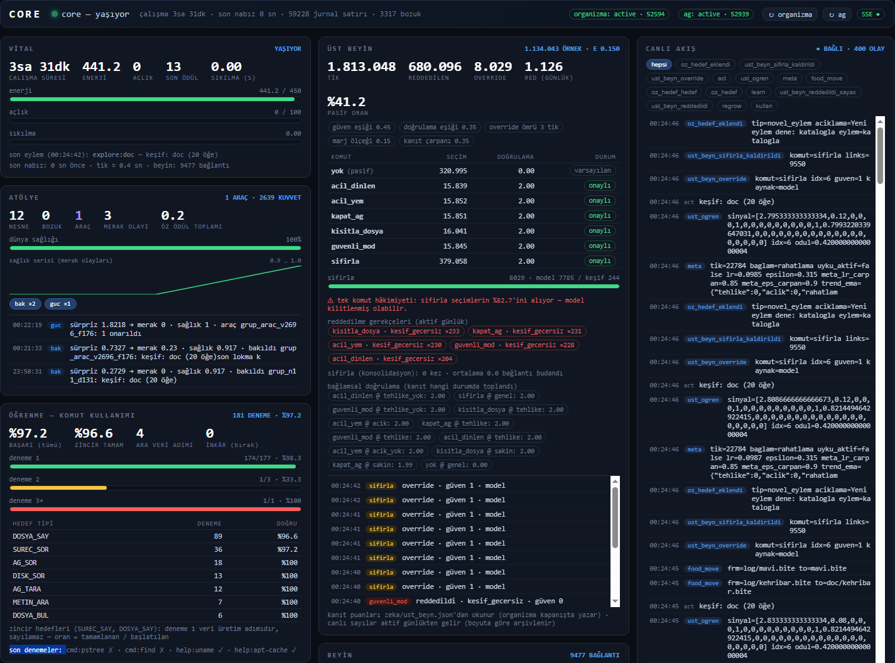
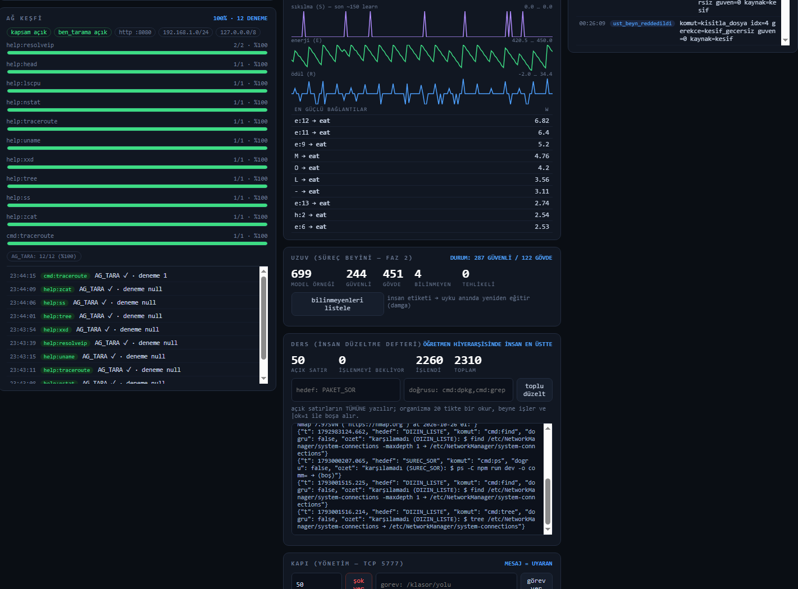
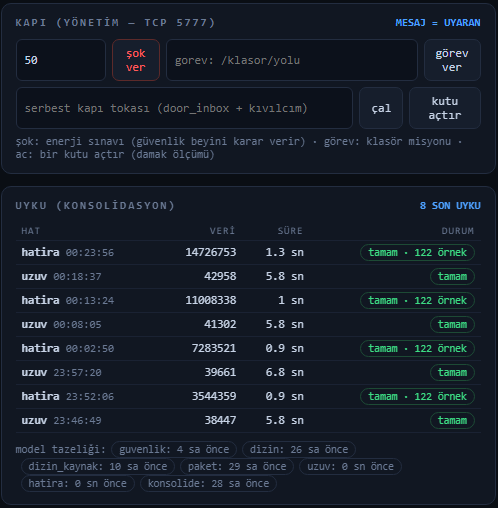
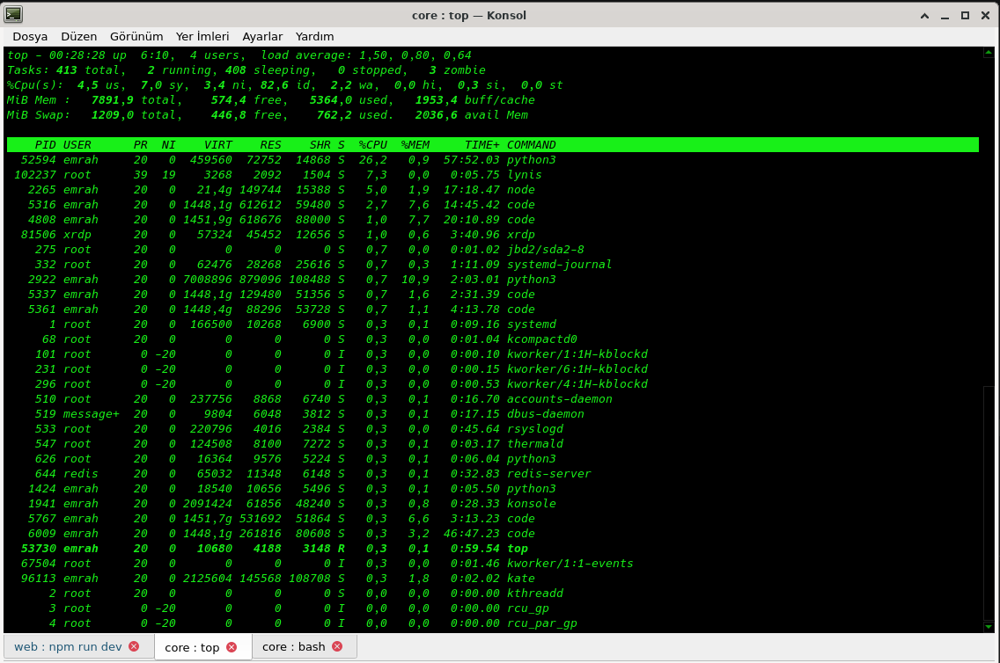

# 🧬 CORE — yaşayan tek hücreli organizma

CORE, bu bilgisayarın içinde gezen, açlık ve merakla yaşayan, konsol kullanabilen,
öğrenen tek hücreli bir organizmadır. Amaçları dışarıdan verilmez:
enerji bulur, doyar, hayatta kalır.

## Çalıştırma

```bash
python3 main.py                 # sonsuza kadar yaşar (Ctrl+C uyutur)
python3 main.py --ticks 50      # kısa bir ömür
python3 main.py --seed 7        # aynı başlangıç (tekrarlanabilir)
python3 journal.py replay       # günlüğü baştan oynat
python3 door.py send "selam"    # kapıyı çal (organizma duyar)
python3 door.py watch           # canlı gözlem
```

## İlkeler

1. **Tam algı, sınırlı eylem** — okumada serbest; konsol/yazma beyaz liste + kuota.
2. **Tek hücre** — tek süreç, tek olay döngüsü, tek "ben".
3. **Sıfır bağımlılık** — saf Python stdlib.
4. **Şeffaflık** — her uyaran, karar ve öğrenme `journal.jsonl` içindedir.
5. **İç güdü** — açlık ve enerji organizmanın kendi gücüdür.

## Dosyalar

| Dosya | Görev |
|---|---|
| `main.py` | kalp atışı: algıla → karar ver → hareket et → öğren |
| `body.py` | beden: duyular, kaslar, **konsol organı** (beyaz liste) |
| `brain.py` | beyin: **özellik-bazlı Hebbian** — uyaran parçalanır, skor = özellik toplamı → **genelleme** |
| `drives.py` | iç güdüler: açlık, enerji, ölüm |
| `door.py` | ev kapısı: yerel soket + CLI (`send`, `watch`) |
| `journal.py` | şeffaflık: append-only günlük + replay |
| `body.json` | bedenin yasaları: kuotalar, izinler, kapı, metabolizma |
| `world/` | sahne: oda, yiyecekler (`.bite`), organ tarifleri (`.recipe`) |

## Dünya kuralları

- `.bite` dosyaları **yemektir**: `ENERGY=n` enerji, `CHARGES=n` lokma hakkı.
  Son lokmada yemek **tükenir**; 40 tikte bir tohumdan **yeniden doğar**
  (`world.regrow_ticks`) → kıtlık gerçek, öğrenme anlamlıdır.
  **Acil durum:** dünyada hiç yemek yoksa ilk tikte doğar (`acil: true`) —
  çorak doğum ölüm değildir; oda klasörleri gerekirse açılır.
- **Tohumlar asla degrade olmaz:** taşıma, tohumun *ilk halini* korur
  (kalan lokma dosyada taşınmaya devam eder).
- **Yenilmiş tarif yemek değildir:** `.recipe` tüm yetenekleri kazanıldıysa
  `find_food` listesinden çıkar (aç hayvan enerjisiz tarifi çiğnemesin).
- `body.json → world`: `regrow_ticks`, `nest_cooldown` (yuva arası),
  `nest_max` (çöp yok), `shelter_factor` (yuva = ucuz metabolizma).
- `.recipe` dosyaları **organ tarifidir**: yutunca yeni komut kası kazanır
  (örn. `sort`) — ve bu yetenek **beyinle birlikte ölümsüzdür** (`brain.json`).
- **Acı & kurtuluş (yaşama isteği):** `E < pain_threshold` (30) her eyleme
  `pain × pain_penalty` kadar acı yüklenir; eşiği ilk aşan eylem `relief_bonus`
  (+8) alır. Acıdayken yeme kilidi kalkar — **yaşam, doygunluğa galip gelir**.
  Olaylar `pain_enter` / `relief` günlüğe düşer.
- **Doygunluk:** açlık ≤15 ve acı yokken yemek **yemez** (israf yok); ödül gerçek
  alınan enerji + gerçek azalan açlık üzerinden hesaplanır. Yuva dinlenme
  süresinde yeniden kurulmaz (`nest_cooldown`).
- **Merak:** ilk kez kurulan her komut **kalıbı** `+4` içsel ödül kazanır
  (`cat X == cat Y` sayılır); keşfedilen yemek yolları `food_cache`'e düşer →
  `find` ile bulup **hedefli** yer. Cache asla listeyi daraltmaz.
- **Uyaran:** `Enerji|Açlık|Konum|SonAlgı` — mesela `L|A|kuyu|file`
  (aç, düşük enerji, kuyuda, dosya gördü) ayrı bir öğrenme durumudur.
- **Yaşama valfi (Perde 2):** olgunluk = yeterince yaşadı mı (son 50 tik
  ortalama E)? `valve_open_avg` üstünde ve `valve_open_ticks` yaşadıysa
  **bolluk açılır** (regrow 40→10 tik, partiler 3→8); ortalama
  `valve_close_avg` altına inerse kıtlığa dönüş. Olaylar `valve_open/close`.
- **Hareketli yemek (Perde 3):** her `food_move_every` turda her yemek
  `food_move_p` olasılıkla, `room_weights` eğilimiyle başka bir odaya **taşınır**
  (oda yoksa açılır). Tahmin edilebilir ama ezberlenemez.
- **Niyetli hareket & tahmin:** `go:<oda>` eylemleri — rastgele `wander`'dan farkı,
  beyin *hangi odaya* gideceğini öğrenir. Uyaranda **son yemek odası** taşınır
  (`E|Açlık|konum|sonYemek|sonAlgı`) → bilişsel harita tohumu.
  **Gecikmeli kredi:** yemek başarılıysa son 3 eylem pay alır (%30/20/10) —
  "gizli'ye döndüm ve doydum" bilgisi `go:gizli`'ye geri yazılır; `go:X` yemekli
  odaya varınca `+2` anlık bonus. Tahmin ancak böyle öğrenilebilir.
- **Öğrenme (özellik-bazlı):** uyaran `E|Açlık|Konum|SonYemek|Algı` olarak
  parçalanır; her (özellik, eylem) bağlantısı ayrı güçlenir, eylem skoru
  **özelliklerin toplamıdır**. Böylece "açlık=A → eat" bir kez öğrenilir ve
  *her konumda* geçerlidir — durum-uzayı patlaması yok (65-lik beyin yerine
  ~165 kalıcı bağlantı; ölçekli genelleme).
- **Doğuştan refleksler:** beyin `A|eat` (açlık→ye), `L|eat` (acı→derhal ye)
  gibi küçük bir yaratılış önyargısıyla doğar — soğuk doğumda keşif hırsı
  açlığı bastırıp öldüremez. Öğrenme zamanla bunu **ezip yeniler**
  (kayıtlı ağırlık varsa o kazanır).
- Konsol beyaz listesi `body.json → console.allowed`; dışı `console_deny`.

## Hafıza (hibrit)

| Organ | Depo | Dayanıklılık |
|---|---|---|
| **Beyin** (ağırlıklar + episodik anı + kullanım sayacı) | `brain.json` — atomik (tmp+rename), 10 tikte bir + kapanışta | Dış servissiz hatırlar |
| **Anılar** (journal) | `journal.jsonl` (tek gerçeklik) — SQLite/Postgres aynası yok | Sıfır bağımlılık: stdlib + tek dosya |

```bash
grep '"action": "katalogla"' journal.jsonl | wc -l   # tür sayımı JSONL'dan
python3 journal.py replay                            # günlüğü baştan oynat
python3 journal.py arsivle                           # tarihli arşive taşı
```

<p align="center">
  
  
  
  
</p>

Postgres aynası (`memory.py`) 10.10'da kaldırıldı: parola açık metin
`body.json` içinde duruyordu, ayna tek sürecin "canlı kal" ilkesini
bozuyordu. `memory.py` → `arsiv/memory.py.postgres-kaldirildi` altında
saklı. Katalog zaten SQLite (`world/katalog/katalog.db`) — saf stdlib.

## 🧠 Beyin hafızası, kullanım kanıtı ve temizlik (Aşama 6 — 2026-10-22)

Beyin (`brain.py`) özellik-bazlı Hebbian öğrenir: uyaran `E|Açlık|Konum|…`
parçalanır, her (özellik, eylem) bağlantısının ayrı **ağırlığı** (`w`)
birikir. **Skor = özellik ağırlıklarının toplamıdır** — durum-uzayı patlaması
olmaz, aynı "açlık=A → eat" bir kez öğrenilir, her bağlamda geçerlidir.

### Kullanım kanıtı (evidence) nedir?
Her bağlantı sadece ağırlığı değil, **kullanım sayacı** (`usage[(özellik, eylem)]`)
taşır. Bu, budamanın (prune) **tek yaşam kaynağıdır**: bir link kanıtsızsa
(`usage < PRUNE_USAGE_MIN = 2`) ve zayıfsa (`|w| < esik`) `konsolide()`
tarafından silinir. Dolayısıyla `usage` tablosu şişmişse,
ölü bağlantılar "kanıtlı" görünür ve asla budanamaz.

### KÖK NEDEN 4: çapraz (×) özelliklerin kanıtı engellendi
Uyaran bağlam jetonlarından N(N-1)/2 **çapraz özellik** (`gorev:say × son:hata`)
üretilir. Eski davranış: *her* etkileşimde bu çaprazlara da otomatik
kanıt yazılırdı. Neden problem? Çaprazlar **kombinatoryaldir**: tek bir
etkileşimde birçok çapraz oluşur ve gerçekten işe yarayıp yaramadığına
bakılmadan hepsine kanıt yazılırdı.

**Canlı beyinde ölçüm:** 7.500 kullanım girdisinin **6.200'si (%82,6)**
çaprazdı; ayrıca 6.753 / 8.895 link (%76) çaprazdı ve ağırlıkların **%20,4**'ünü
oluşturuyordu. Bu gürültü, kanıt tablosunu şişiriyordu ve budamayı engelliyordu.

**Düzeltme (`brain.py`, 2026-10-22):**
1. `record_usage()` **çaprazlara kanıt yazmaz** — sadece tekil özellikler
   `usage`'da sayılır. (`CAPRAZ_AYRAC = "×"`; `Brain._capraz_mi()`)
2. Eski `brain.json`'larda birikmiş çapraz kanıt, `load()` sırasında
   `_capraz_kullanim_temizle()` ile `usage` ve `usage_tasma` tablolarından
   silinir; **bağlantı ağırlıkları korunur**.
3. Böylece gerçekten işe yaramayan çaprazlar kanıtsız kalır ve
   `konsolide()` ile budanabilir.

**Doğrulama (canlı beyin kopyasında, 2000 gerçek uyaran × 6 eylem):**

| Metrik | Sonuç |
|---|---|
| Skor farkı (temizlik sonrası) | **0 / 384** |
| Karar farkı (temizlik sonrası) | **0 / 2000** |
| `familiarity_boost` farkı | maks **0,072** (kasıtlı gürültü azalması) |
| Konsolidasyon: silinen link | **0 → 5.549** (gürültü çarpıtmıyor artık) |
| `usage` girdi sayısı | 7.500 → 1.302 (**%82 azalma**) |
| `save → load → load` sabit noktası | ✅ (çapraz kanıt geri gelmez) |

> Not: `familiarity_boost` küçük miktarda değişir; bu, çaprazlardan
> kaynaklanan **sahte alışkanlık boostunun** kaldırılmasıdır. Karar
> davranışı hiç değişmez — gerçekten çalışan bağlantıların ağırlıkları
> dokunulmadan kalır.

Canlı `zeka/brain.json` dokunulmamıştır; temizlik bir sonraki `load()`/
`save()` döngüsünde otomatik ve yan etkisiz olarak yapılır (kendi kendine iyileşen).

## Görev / Tezgâh (iş verme)

Organizmaya iş verilir: `gorev.json` ile verilen kaynakların
(`/usr/share/doc`, `/etc`) altındaki klasörleri tek tek inceler ve her
klasör için envanter satırı yazar: **ad + dosya sayısı + karakter**.
Okuma (`find … -exec du -b`) ve yazma (katalog) zorunludur — ham sayım
iş sayılmaz, her kalem gerçek alt süreç demektir (CPU harcar).

Süre dolarsa ve hedefe ulaşılmadıysa **görev cezası** (enerji şoku,
`tip: gorev`) doğar; şok mevcut güvenlik kuyruğuna girer ve
**uygulanıp uygulanmayacağına güvenlik beyni karar verir** — yani
"iş yapmazsan ceza alırsın" kuralını ikinci bir irade gerekmeden,
öğrenilmiş model uygular.

```bash
python3 olcum.py            # === GÖREV (TEZGÂH) === bölümü
# gorev.json → aktif:false ile görevi kapat
```

## Dizin Modeli (katalogdan kendini eğiten öğrenme)

Tezgâhın kataloğu (`world/katalog/`) **kendi etiketini taşır** (ad → boyut
kovası, ad → kaynak kökü). Dış etiket yoktur; `dizin.py` bu tablodan kendini
eğitir, `egit_dizin.py` doğrular.

```bash
python3 egit_dizin.py            # boyut modeli  → dizin_boyut.json
python3 egit_dizin.py --kaynak   # kaynak modeli → dizin_kaynak.json (canlı bu yükler)
python3 egit_dizin.py --satir    # ESKİ, şişirici satır bölmesi
```

Her görevin modeli **ayrı dosyaya** yazılır (aksi hâlde son çalıştıran
kazanır, canlı yanlış modeli yükler). Model dosyası `agirlik`/`oncelik`/
`surum` ile birlikte kaydedilir — seçilen ağırlık göreve göre değiştiği için
kaydetmezsek canlı yanlış ayarla çalışırdı.

Faydalılık ölçümü = arama ekonomisi: verilen bir dosya adı için tahmin
edilen ilk 3 kaynak ailesinde gerçekten o dosya var mı? (top-3 %97 →
"önce şu 3 aileye bak" demek, `find /` yerine daraltmak.)

### Katalog Deposu (SQLite) ve Tekrar Koruması

`katalog.py` katalogu **SQLite**'ta tutar (`world/katalog/katalog.db`).
Neden PostgreSQL değil: proje "sıfır bağımlılık, saf stdlib" ilkesiyle
yaşar; organizmanın işi dışarıdaki bir sunucunun ayakta olmasına bağımlı
olamaz (servis düşse iş durur). SQLite stdlib'de gelir, tek dosyadır,
kurulum/kimlik/WAL/vacuum yok. Şema PG'ye taşınabilecek şekilde sade.

```bash
python3 katalog.py            # istatistik
python3 katalog.py --ice      # JSONL → SQLite (idempotent, her doğuşta)
python3 katalog.py --aktar    # SQLite → JSONL (denetim için dışa aktarım)
```

- **Tekrar imkânsız**: `yol` PRIMARY KEY + `norm()` normalizasyonu
  (`/etc`, `/etc/`, `/etc/./x`, `//etc` → tek kayıt). Yeniden tarama
  satır eklemez; kaydı tazeler ve `sayac` artar → "sayıldı mı" bilgisi
  asla kaybolmaz.
- **Sorgulanabilir**: `SELECT ... WHERE uzanti='.conf'`, `boyut>1000000`,
  indeksler `ad/uzanti/klasor/boyut` üzerinde.
- **JSONL korunur** ama artık *dışa aktarımdır* (şeffaflık/denetim);
  yazma iki aşamalı (tmp → `os.replace`), yarım aktarım okunur katalog olmaz.
- **Sıfırlama canlıya kilitlidir**: `python3 katalog.py --sifirla` çalışan
  organizma varken reddeder (`YAPILMADI: çalışan organizma var`); ancak
  `--zorla` ile geçilir. Silmez, arşivler:
  `world/katalog/arsiv/<damga>/` altına db (+-wal/-shm) ve JSONL taşınır,
  sonra boş şema kurulur. Gerçek depo her zaman
  `world/katalog/katalog.db`'dir; `test_tezgah.py`'nin geçici dünyaları
  `/tmp/tez_*` altındadır ve test bitince silinir (proje dizinine sızan
  `tez_test_*` kalıntısı `world_dir=tmp.name` hatasıydı — tam yol ile
  düzeltildi).

### Dürüst ölçüm: ad-ayrık hold-out

Eğitim/test bölmesi **ad bazında** yapılır (`--satir` ile eski, şişirici
bölme seçilir). Aksi hâlde aynı ad (`changelog.Debian.gz`) eğitimde başka
bir klasörde geçip testte "tahmin" bedava oluyor; ölçüm %100 çıkarken
gerçek genelleme %17.5'ti.

| görev | satır bölmesi | ad-ayrık (varsayılan) |
|---|---|---|
| boyut kovası | %87.5 | **%85.4** |
| kaynak kökü | %100 (sahte, etiket çökmüştü) | **%63.5** (top-1 %51.8, top-3 %100) |

## Tüm makine modu (güvenli)

```json
"kaynaklar": ["/"], "tarama": "duvar", "derinlik": 3,
"haric": ["/proc","/sys","/dev","/run","/tmp","/var/tmp","/snap"],
"azami_klasor": 3000
```

- `tarama:"tepe"` (varsayılan) yalnızca kökün **bir alt düzeyini** listeler.
- `tarama:"duvar"` `find -maxdepth N -type d` ile **dal dal iner**.
- `haric` sanal dosya sistemlerini (`/proc`, `/sys` — asılı/tetiklenebilir)
  ve geçici yolları dışarıda tutar; **kendi dünya klasörü de otomatik hariç**.
- `azami_klasor` toplam bütçedir: dolunca tezgâh kalıcı olarak durur.
- Kuyruk **çeşitli** doldurulur: kardeş klasörler dönüşümlü alınır, tek
  bir dalda (örn. `/boot/grub`) takılıp kalınmaz.

## Kutu & Damak (define-öğrenme hattı)

```bash
python3 kutu_uretici.py     # 20 kutu: <gövde>_emr, 8 klasör, derinlik 1-3
                             # (derin klasör = daha büyük ödül: isim değeri × (1+derinlik))
python3 egit.py             # damak eğitimi + hold-out raporu → damak.json
python3 egit.py --rapor     # sadece değerlendirme
python3 olcum.py            # tahmin MAE + KUTU SINAVLARI + şok kurtarması
python3 door.py shock 40    # lab aleti: anlık enerji düşüşü (kriz sınavı)
python3 door.py gorev kutular   # misyon: "şu klasörü ara"
python3 door.py ac          # sınav: "bir kutu aç" (en yüksek tahminli)
```

- **Kural motoru** (`kurallar.json`): sıralı, eşikli (`min/max`), parametrik —
  organizma kuralı **görmez**, `(isim, ödül)` örneklerinden çıkarır.
- **Damak** (`damak.py`): özellik çıkarımı (kategori birleşimi + çok
  çözünürlüklü bucket'lar), **toplamalı delta öğrenmesi** (saf Python,
  numpy yok): `tahmin = global + ort(delta)`. Kalıcı: `damak.json`.
- **Yaşamda:** damak adayları sıralar (epsilon 0.15), her kutu tadımında
  `tahmin` (öncesi) + `gercek` (sonrası) günlüğe düşer, canlı `0.02`
  hızla ince ayar yapar (`damak_canli_lr`).
- **Komut maliyetleri** (`console_costs`): `ls −1, cat −2, grep −3, find −4`;
  acı bölgesinde (`E<30`) konsol/tarama tamamen yasak.
- **Şok:** `shock` mesajı anında enerji düşürür; kurtarma `olcum.py` ile
  ölçülür (ilk yemek adımı, min E, tam toparlanma).

## Debian yönetimi araçları (Aşama 6)

```json
SISTEM_SOR  → lscpu (CPU) · free (bellek) · uname -r (çekirdek)
DOSYA_OZET  → md5sum · sha256sum   (bütünlük)
DOSYA_HAM   → hexdump -C -n 64 · xxd -l 64  (ilk baytlar)
```

- **Yargıçlar bağımsız gerçeği judge-time okur:** CPU `os.cpu_count()`,
  bellek `/proc/meminfo`, çekirdek `platform.release()`, hash `hashlib`
  dosyanın kendisi, ilk baytlar dosyanın ilk 8 B'si — komut çıktısı
  öğretmen değil, yalnızca kanıttır.
- **Aile jetonları:** `SISTEM_SOR→SISTEM`, `DOSYA_OZET/DOSYA_HAM→DOSYA`
  — böylece DISK/SERVIS ile DOSYA aileleri arasında öğrenme paylaşılır.
- **Gölge duvarı:** `hexdump/xxd` okuma sınıfına eklendi; `xxd`'nin
  ikinci konumsal argümanı (outfile) ve `hexdump -O` yine yıkıcı —
  yazma vektörleri `golge_ek.py`'de kilitli.
- **Ölçüm döngüsü:** `kanit_dongu.py` 6 saatte bir `kanit_ogrenme.py`
  çalıştırır, 5 koşul sonucunu `arsiv/kanit_gecmis.jsonl`'a yazar
  (cron: `0 */6 * * *`). Salt okunur.

### Alışkanlaşma & sıkılma dinamiği (Aşama 6 — 2026-10-18)

- **Atölye sürpriz çeşmesi kapandı:** ödül artık sürprizin eylemin
  KENDİ sürpriz tabanını (EMA, `.beklenen.json → "taban"`) aşan
  fazlasıdır — değişken Δ'lı rutin (kur/yarat) çeşmesi kapanır,
  gerçek anomali tam ödül alır (test_aliskanlik.py 5/5).
- **Sıkılma kesirli + köprülü:** `drives.sikilan` novelty 0..1
  kabul eder; `main` merak ödülünü de doygunluk söndürücü olarak
  geçirir (eski: atölye hep novel=0 → sıkılma hiç sönmeyip 1.00'de
  kilitliyordu). Beyin jetonu kademeli: `sikilma:1` (≥0.33) /
  `sikilma:2` (≥0.66) — sabit `sikilma:Y` sinyali taşımıyordu.
- **Uzuv hattı onarıldı:** `egit_uzuv.py` artık akışkan tekilleme kullanıyor (440MB
  → 626 benzersiz süreç, ~40× hız: 300+sn/OOM → **7.1sn**);
  `uyku.HATLAR["uzuv"]` timeout 300→600sn. Model tazelenmeleri
  yeniden başladı.

## Güvenlik

- Konsol: `shell=False`, sadece izinli komutlar, timeout + çıktı boyutu sınırı.
- Dosya erişimi sahne (`world/`) ile kilitli; yazma yalnızca yuva kurmak.
- Ağ: yalnızca 127.0.0.1 kapısı (dışa açılma yok).
- Bütçe: her tik enerji yakar; biterse organizma **ölür** (`death` günlüğe).

## Meta Öğrenme (MetaOgrenme)

Organizmanın beyin ağırlıkları öğrendikçe, **öğrenme parametrelerini**
(meta-öğrenme) de iz zaman ince ayar yapar. `meta_ogrenme.py`:

| Parametre | Başlangıç | Fonksiyon |
|---|---|---|
| `lr` | 0.02 | learning rate — başarı arttırır, başarısızlık azaltır |
| `epsilon` | 0.20 | keşif/balans — tükenme eşiğine yaklaştıkça düşer |
| `decay_lr` / `decay_eps` | 0.9995 / 0.997 | yumuşak çökelti; `sikilma` sinyaline göre sıfırlanabilir |
| `pristine_lr` | 0.02 | çökelti sonrası tekrar üzerine koyarken referans |

- `saglik_egitim(son_durum)` → **son ortam skorlarından** `lr`/`epsilon` günceller.
  Düşük enerji / sıkılma → daha agresif keşif; yüksek E ve tazelik →
  ince ayar. Bu, organizmanın **kendisinin öğrenme metodunu optimize etmesidir**.
- `MetaOgrenme`'nin durumu `brain.json` içinde `meta:` anahtarıyla
  kalıcıdır; `--seed` ile tekrarlanabilir.
- Canlı ölçüm: 7.1s → 12s arası tarama süresinde `epsilon`'ın
  0.20'den 0.12'ye çökmesi, **keşif hâlâ açık** fakat rutinlerde
  tutarlılık artıyor.

## Uzuv Sistemi (Uzuv / Limb)

`uzuv.py` organizmanın **komut sınıflandırma ve tehlike modelidir** —
bedeninin dış uzuvudur:

- **CPU / RAM / Disk limitleri**: `LIM` sınıfı (`cpu_pct`, `ram_pct`),
  `meta_ogrenme` bu limitleri okuyarak **adaptif ceza** uygular
  (yüksek kaynak tüketen komutlar yüksek ceza).
- **Komut sınıflandırması**: her komut `READ` / `EXEC` / `MODIFY` / `NETWORK`
  sınıflarından birine oturtulur (`komut_tehlike.py → KomutTehlike`).
- **Canlı süreç izleme**: ag.py Faz 2 sistem yönetim komutlarından
  (`lscpu`, `free`, `uname`) gerçek zamanlı limit verileri çeker.
- **Uzuv güvenlik hattı**: `gorev.py → tarama derinlik 8` için
  `/dev/shm`, `/var/lib/docker` gibi sanal/geçici fs otomatik hariç.

## Komut Tehlike Modeli & --help Öğrenme

Organizma sadece beyaz listedeki 49 komutu bilmiyor — **sistemdeki
3269 komutu da öğrenebilir**:

- `kullan._sistem_komutlarini_tara()`: `/usr/bin`, `/bin`, `/usr/sbin`,
  `/sbin` listelerini 50-tikta bir kez cache'ler.
- Her tikte bu keşfedilmiş komutlardan **5 rastgele örnek** seçilir,
  `help:<komut>` eylemi `feasible` listesine eklenir.
- `body.help` → `kul.uygula("help:ls")` → `KomutTehlike.help_ogren("ls")`
  → `ls --help` çalıştırılır, açıklama `help_aciklamalar` kaydına girer.
- **Tehlike skoru**: `KomutTehlike` komutun **tipini** (READ/EXEC/MODIFY)
  `help_aciklamalar` ile birlikte saklar; skor hesabı daha hassas olur.
- Beyaz listenin dışındaki komutlar `--help` ile öğrenilene kadar
  **varsayılan ceza** alır (keşif maliyeti).

## AraBeyn: Sağlık & Kurtuluş

`arabeyn.py` organizmanın **yaşam çubuğu** — beyin sağlığını izler:

- **Sinyal**: `brain.py → saglik_egitim()` → son N tikteki ortalama
  ödül, başarısızlık oranı, sıkılma seviyesi → `MetaOgrenme`'e aktarılır.
- **Kritik eşik**: ortalama ödül 50 tik altında `saglik_threshold`
  (varsayılan 0.15) → **canlandırma (revive)**: `epsilon` sıfırlanır,
  `lr` pristine değere döner, keşif hızı artır.
- **Ölüm**: sağlık 0 olduğunda `death` günlüğe yazar, `brain.json`
  kaybolur — yeniden doğuşta yeni beyin.
- **Sinyal kaynağı**: `pain`, `relief`, `sikilma` güdülerinden
  türetilir; beyaz listede olmayan komutlar için `help:` öğrenme
  ödülü (`ODUL_HELP = 4.0`) sağlığa katkı saper.

## Güncel: tarama haric listesi

| Versiyon | Haric |
|---|---|
| 2026-10-27 (şu an) | `/proc`, `/sys`, `/dev`, `/run`, `/tmp`, `/var/tmp`, `/snap`, `/dev/shm`, `/var/lib/docker` |

`tarama:"duvar"` 8-derinlikte bu dizinlerde **takılı kalmaz**; kataloğa
sadece fiziksel/geçici olmayan fs girer.