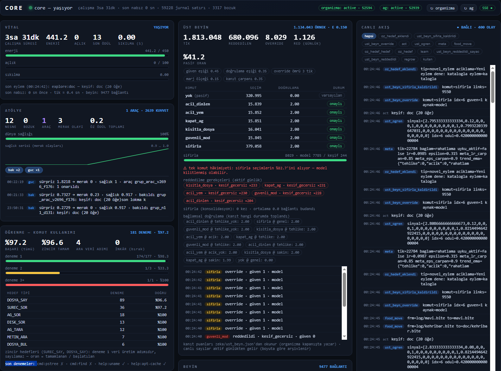
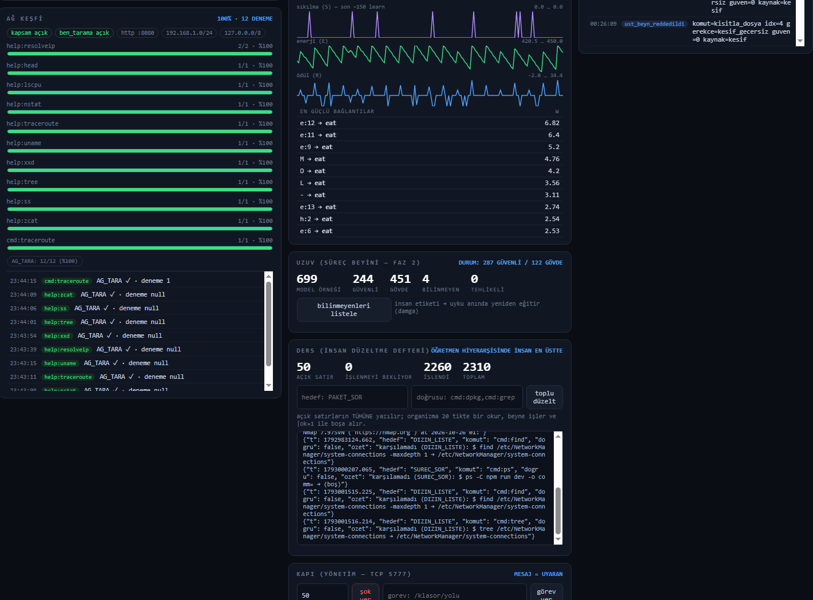
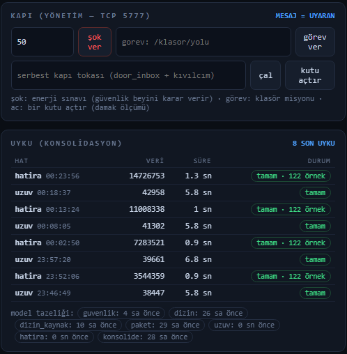
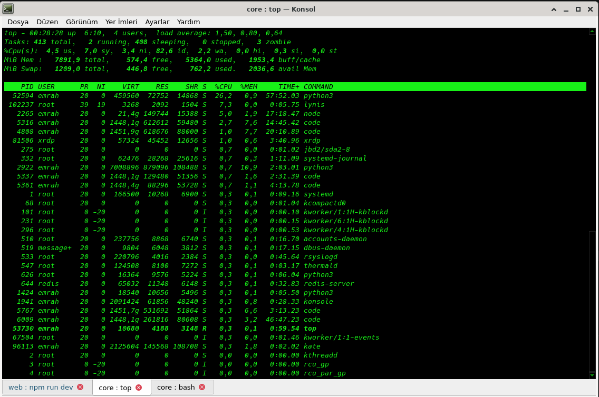

# 🧬 CORE — yaşayan tek hücreli organizma

CORE, bu bilgisayarın içinde gezen, açlık ve merakla yaşayan, konsol kullanabilen,
öğrenen tek hücreli bir organizmadır. Amaçları dışarıdan verilmez:
enerji bulur, doyar, hayatta kalır.

## Çalıştırma

```bash
python3 main.py                 # sonsuza kadar yaşar (Ctrl+C uyutur)
python3 main.py --ticks 50      # kısa bir ömür
python3 main.py --seed 7        # aynı başlangıç (tekrarlanabilir)
python3 journal.py replay       # günlüğü baştan oynat
python3 door.py send "selam"    # kapıyı çal (organizma duyar)
python3 door.py watch           # canlı gözlem
```

## İlkeler

1. **Tam algı, sınırlı eylem** — okumada serbest; konsol/yazma beyaz liste + kuota.
2. **Tek hücre** — tek süreç, tek olay döngüsü, tek "ben".
3. **Sıfır bağımlılık** — saf Python stdlib.
4. **Şeffaflık** — her uyaran, karar ve öğrenme `journal.jsonl` içindedir.
5. **İç güdü** — açlık ve enerji organizmanın kendi gücüdür.

## Evren gözlemi

- CORE bilgisayarı sınırlı, salt-okunur kaynak/bellek/disk/ağ-arayüzü
  özetleriyle kendi “evi” olarak gözlemler; bu özetler beyin uyaranına
  kompakt bağlam jetonları olarak eklenir.
- İnternet gözlemi varsayılan olarak kapalıdır. Açmak için `body.json` içinde
  `environment.internet.enabled` değerini `true` yapıp `allowlist` listesine
  yalnızca açıkça izin verilen HTTPS origin'lerini ekleyin
  (ör. `https://example.org/`). En çok beş origin, saatte bir ve en fazla
  iki saniyelik zaman aşımıyla salt-okunur GET yapılır.
- İstekler yönlendirmeleri izlemez; DNS'in yalnızca genel IP'lere çözümlendiği
  doğrulanır ve bağlantı doğrulanan IP'ye sabitlenir. Yanıttan yalnızca HTTP
  durumu ve içerik türü alınır; yanıt gövdesi okunmaz veya öğrenme belleğine
  konmaz.
- Dış erişimi kapatmak için `enabled: false` bırakın veya izin listesini boşaltın.
- Yerel süreç gözlemcisi her `surec.periyot` tikte bir süreç adlarını ve
  anonimleştirilmiş sayaçlarını (süreç adedi, CPU süresi, bellek ve çalışma
  durumu) toplar. PID, komut satırı argümanları ve içerikler kaydedilmez.
  Son 120 örnek ve süreç/CPU/bellek için çevrimiçi ortalama profilleri
  `zeka/surec.json` içinde tutulur; sistem yükündeki sapma üst beyin sinyaline
  verilir, böylece karar modeli yerel işleyiş örüntülerini öğrenebilir.

## ASM öğrenimi

- Üst beyin `asm_ogren` komutunu seçtiğinde, enerji 30'un üzerindeyse ve
  tehlike yoksa kısa bir ASM öğrenme oturumu başlatır. Aynı komut aralıksız
  seçildiği sürece oturum yalnızca bir kez çalışır; görev/başarı sonucu üst
  beyin ödülüne aktarılır.
- ASM organı şu anda üretilmiş girdi/çıktı görevlerinde x86-64 programları
  arar ve doğrular. Bu, genel işletim sistemi sorunlarını kendi başına
  teşhis edip çözmek anlamına gelmez; gerçek bir sorunu çözebilmesi için
  sorunun güvenli biçimde tanımlandığı bir görev arayüzü gerekir. Üretilen
  görevler artık 6 eğitim ve 4 ayrı doğrulama girdisi kullanır; küçük
  değerlerin yanında 64-bit sınır değerlerini de dener. Son komutun bayrak
  etkisi emülatör tarafından güvenilir biçimde modellenebiliyorsa ZF/CF/OF
  da doğrulama çıktısına katılır. Arama bütçesi ve oturumun kalan süresi
  çözücüye aktarılır; doğru çözülen çok komutlu programlar aynı bağlamda
  sonraki aramalarda yeniden denenir. Bağlam anahtarı tüm gözlenen yazmaç
  ilişkilerini içerecek şekilde sürümlüdür; bu nedenle eski ağırlık kayıtları
  yeni bağlamlarla doğrudan eşleşmez. Her otomatik çözüm, eğitim/doğrulama
  kümesinden ayrı 64-bit sınır desenleriyle emülatör ve CPU arasında yeniden
  karşılaştırılır. Bellek kullanan görevlerde yazmaç adresleri 2 GiB'ye kadar
  sınırlandırılmış veri alanına göreli adreslerdir; emülatör yalnızca erişilen
  baytları saklar, CPU doğrulaması gereken adres aralığını ayırır. Bağımsız
  bellek probları üst sınır adresini de kapsar. Emülatörün
  bayrak ve bellek davranışı ayrıca bilinen sonuçlu regresyon testleriyle
  kontrol edilir. Kullanıcı örneklerinde bağımsız beklenen sonuçlar
  üretilemediğinden doğrulama, verilen eğitim ve hold-out örnekleriyle sınırlıdır.
- Belirli bir problemi örneklerle çözmek için `UstBeyn.asm_ornek_coz` veya
  `AssemblyLearner.solve_examples` kullanılabilir. Her örnek
  `{"input": {"rax": 2}, "output": {"rax": 3}}` biçimindedir; en az bir
  eğitim ve bir ayrı doğrulama örneği verilir. Yazılmayan girdiler sıfır,
  çıktıda belirtilmeyen yazmaçlar değişmeden kalır. Çözücü adayları emülatörde
  ve doğrulama örneklerinde gerçek makinede denetler; doğrulama girdileri
  eğitim girdileriyle çakışamaz. Bu arayüz eğitim durumunu ya da ASM bilgi
  deposunu değiştirmez; işlem bütçesi, komut uzunluğu ve zaman aşımıyla sınırlıdır.
- Komut satırından kullanmak için JSON dosyasında `training` ve `validation`
  dizilerini tanımlayın ve `python3 uzuv/asm_ogren.py --coz-json gorev.json`
  komutunu çalıştırın. `--seviye`, `--azami-komut`, `--butce` ve
  `--zaman-asimi` seçenekleri aramayı sınırlar; sonuç tek JSON nesnesi olarak
  stdout'a yazılır. Bulunamayan veya doğrulamadan geçemeyen çözüm başarı sayılmaz.

## Dosyalar

| Dosya | Görev |
|---|---|
| `main.py` | kalp atışı: algıla → karar ver → hareket et → öğren |
| `body.py` | beden: duyular, kaslar, **konsol organı** (beyaz liste) |
| `brain.py` | beyin: **özellik-bazlı Hebbian** — uyaran parçalanır, skor = özellik toplamı → **genelleme** |
| `drives.py` | iç güdüler: açlık, enerji, ölüm |
| `door.py` | ev kapısı: yerel soket + CLI (`send`, `watch`) |
| `journal.py` | şeffaflık: append-only günlük + replay |
| `ag_beyin.py` | yerel ağ araç/beceri belleği, doğrulanmış sonuçlardan sınırlı seçim öğrenmesi |
| `social_learning.py` | açıkça etkinleştirilirse izole kopyalar arasında yerel beceri özeti paylaşımı |
| `body.json` | bedenin yasaları: kuotalar, izinler, kapı, metabolizma |
| `world/` | sahne: oda, yiyecekler (`.bite`), organ tarifleri (`.recipe`) |

## Dünya kuralları

- `.bite` dosyaları **yemektir**: `ENERGY=n` enerji, `CHARGES=n` lokma hakkı.
  Son lokmada yemek **tükenir**; 40 tikte bir tohumdan **yeniden doğar**
  (`world.regrow_ticks`) → kıtlık gerçek, öğrenme anlamlıdır.
  **Acil durum:** dünyada hiç yemek yoksa ilk tikte doğar (`acil: true`) —
  çorak doğum ölüm değildir; oda klasörleri gerekirse açılır.
- **Tohumlar asla degrade olmaz:** taşıma, tohumun *ilk halini* korur
  (kalan lokma dosyada taşınmaya devam eder).
- **Yenilmiş tarif yemek değildir:** `.recipe` tüm yetenekleri kazanıldıysa
  `find_food` listesinden çıkar (aç hayvan enerjisiz tarifi çiğnemesin).
- `body.json → world`: `regrow_ticks`, `nest_cooldown` (yuva arası),
  `nest_max` (çöp yok), `shelter_factor` (yuva = ucuz metabolizma).
- `.recipe` dosyaları **organ tarifidir**: yutunca yeni komut kası kazanır
  (örn. `sort`) — ve bu yetenek **beyinle birlikte ölümsüzdür** (`brain.json`).
- **Acı & kurtuluş (yaşama isteği):** `E < pain_threshold` (30) her eyleme
  `pain × pain_penalty` kadar acı yüklenir; eşiği ilk aşan eylem `relief_bonus`
  (+8) alır. Acıdayken yeme kilidi kalkar — **yaşam, doygunluğa galip gelir**.
  Olaylar `pain_enter` / `relief` günlüğe düşer.
- **Uyarlanır beslenme:** yemek yalnız enerji kapasitesinin %65'ine inince veya
  açlık 40'a ulaşınca yapılabilir; acil enerji ihtiyacı bu eşiği daima açar.
  Eşikler `body.json → metabolism` içindeki `eat_energy_ratio` ve
  `eat_hunger_threshold` ile ayarlanır.
- **Güvenli keşif:** enerji kapasitesinin en az %70'i, açlık en fazla 30 ve
  homeostaz en az 0.65 iken yerel keşif her 40 tikte denenir (diğer durumlarda
  100 tikte). Ağ tarama görevleri daha sık tetiklenmez.
- **Görev ölçümü:** ara adımlı komut zincirinde veri üreten adım ilerleme olarak
  kaydedilir; yalnızca hedefi karşılayan veya deneme sınırında kalan sonuçlar
  görev başarısı/başarısızlığıdır. Ödül tahmin güveni hem örnek sayısını hem
  gözlenen ödül değişkenliğini dikkate alır.
- **Merak:** ilk kez kurulan her komut **kalıbı** `+4` içsel ödül kazanır
  (`cat X == cat Y` sayılır); keşfedilen yemek yolları `food_cache`'e düşer →
  `find` ile bulup **hedefli** yer. Cache asla listeyi daraltmaz.
- **Uyaran:** `Enerji|Açlık|Konum|SonAlgı` — mesela `L|A|kuyu|file`
  (aç, düşük enerji, kuyuda, dosya gördü) ayrı bir öğrenme durumudur.
- **Yaşama valfi (Perde 2):** olgunluk = yeterince yaşadı mı (son 50 tik
  ortalama E)? `valve_open_avg` üstünde ve `valve_open_ticks` yaşadıysa
  **bolluk açılır** (regrow 40→10 tik, partiler 3→8); ortalama
  `valve_close_avg` altına inerse

## 7. Kullanıcı Kılavuzu & FAQ

### Genel Bilgiler
- **CORE nedir?** CORE, açlık ve merakla yaşayan, konsol kullanabilen ve öğrenen tek hücreli bir organizma. Amaçları dışarıdan verilmez: enerji bulur, doyar, hayatta kalır.
- **Çalışma prensibi:** `main.py` sonsuz döngü içinde algı → karar → hareket → öğrenme adımlarını tek tek tekrarlar.

### Başlatma Seçenekleri
```bash
python3 main.py                 # sonsuza kadar yaşar (Ctrl+C ile durdurulabilir)
python3 main.py --ticks 50      # 50 tick kısa bir deney yap
python3 main.py --seed 7        # aynı başlangıç koşulları ile tekrar edilebilir
```
- `--ticks`: Kaç oyun turunun oynanacağını belirler.
- `--seed`: Tekrarlanabilir başlangıç için seed değeri.

### Temel Kavramlar

1. **Tam Algı, Sınırlı Eylem** — okumada serbest; konsol/yazma beyaz liste + kuota.
2. **Tek Hücre** — tek süreç, tek olay döngüsü, tek "ben".
3. **Sıfır Bağımlılık** — saf Python stdlib.
4. **Şeffaflık** — her uyaran, karar ve öğrenme `journal.jsonl` içindedir.
5. **İç Güdü** — açlık ve enerji organizmanın kendi gücüdür.

### Dünya Kuralları
- `.bite` dosyaları yemektir: `ENERGY=n` enerji, `CHARGES=n` lokma hakkı.
- Son lokmada yemek tükenir; 40 tikte bir tohum yeniden doğar (`world.regrow_ticks`).
- **Acil durum:** dünyada hiç yemek yoksa ilk tikte doğar (`acil: true`) — çorak doğum ölüm değildir.
- **Tohumlar asla degrade olmaz:** taşıma, tohumun *ilk halini* korur.
- **Yenilmiş tarif yemek değildir:** `.recipe` tüm yetenekleri kazanıldıysa `find_food` listesinden çıkar.
- **Metabolizma ayarları:** `body.json → world`: `regrow_ticks`, `nest_cooldown`, `nest_max`, `shelter_factor`.

### Pain & Kurtuluş (Yaşama İsteği)
- `E < pain_threshold (30)` her eyleme `pain × pain_penalty` kadar acı yüklenir.
- Eşiği ilk aşan eylem `relief_bonus (+8)` alır.
- Acıdayken yeme kilidi kalkar — **yaşam, doygunluğa galip gelir**.
- Olaylar `pain_enter` / `relief` günlüğe düşer.

### Doygunluk
- Açlık ≤15 ve acı yoksa yemek **yemez** (israf yok); ödül gerçek alınan enerji + azalan açlık üzerinden hesaplanır.
- Yuva dinlenme süresinde yeniden kurulmaz (`nest_cooldown`).

### Merak
- İlk kez kurulan her komut **kalıbı** `+4` içsel ödül kazanır (`cat X == cat Y` sayılır).
- Keşfedilen yemek yolları `food_cache'e` düşer → `find` ile bulup **hedefli** yer.
- Cache asla listeyi daraltmaz.

### Uyaran
- `Enerji|Açlık|Konum|SonAlgı` — mesela `L|A|kuyu|file` (aç, düşük enerji, kuyuda, dosya gördü) ayrı bir öğrenme durumudur.

### Yaşama Valfi (Perde 2)
- Olgunluk = yeterince yaşadı mı (son 50 tik ortalama E)?
- `valve_open_avg` üstünde ve `valve_open_ticks` yaşadıysa **bolluk açılır** (regrow 40→10 tik, partiler 3→8).
- Ortalama `valve_close_avg` altına inerse bolluk kapanır.

### Komutlar & Keşif
- **Beyaz Liste:** 49 temel komut; sistem 3269 ek komutu da keşfedebilir.
- **Help Sistemi:** Aktif hedefin komut haritasındaki henüz açıklanmamış komutlar için `help:` eylemi sunulur. `python3 main.py --help` ise yalnızca CLI yardımını gösterir.
- **İlk-keşif ödülü:** İlk `help:` keşfi `ODUL_HELP = 4.0` kazandırır; yardım çıktısı görev başarısı sayılmaz ve tekrar eylemi sunulmaz.
- **Komut Tipleri:** `READ / EXEC / MODIFY / NETWORK` sınıfları; help çıktısındaki keyword'ler word‑boundary regex ile refine edilir.

### Uzuv Sistemi (LIMITLER)
- **CPU / RAM / Disk limitleri:** `LIM` sınıfı (`cpu_pct`, `ram_pct`) aracılığıyla izlenir.
- Yüksek kaynak tüketen komutlar (`rm`, `wipefs`, `mkfs`, `iptables` vb.) yüksek ceza alır.
- Komut tipi (READ/EXEC/MODIFY/NETWORK) göre ayrı limitler uygulanır.

### AraBeyn: Sağlık & Kurtuluş
- **Sinyal:** `brain.py → saglik_egitim()` → son N tikteki ortalama ödül, başarısızlık oranı, sıkılma seviyesi → `MetaOgrenme`'e aktarılır.
- **Kritik eşik:** Ortalama ödül 50 tik altında `saglik_threshold` (varsayılan 0.15) → **canlandırma (revive)**: `epsilon` sıfırlanır, `lr` pristine değere döner, keşif hızı artır.
- **Ölüm:** Sağlık 0 olduğunda `death` günlüğe yazar, `brain.json` kaybolur — yeniden doğusta yeni beyin.
- **Sinyal kaynağı:** `pain`, `relief`, `sikilma` güdülerinden türetilir; beyaz listede olmayan komutlar için `help:` öğrenme ödülü (`ODUL_HELP = 4.0`) sağlığa katkı saper.

### Güncel: Tarama Hariç Listesi
| Versiyon | Hariç |
|---|---|
| 2026‑10‑27 (şu an) | `/proc`, `/sys`, `/dev`, `/run`, `/tmp`, `/var/tmp`, `/snap`, `/dev/shm`, `/var/lib/docker` |

`tarama:"duvar"` 8‑derinlikte bu dizinlerde **takılı kalmaz**; kataloğa sadece fiziksel/geçici olmayan fs girer.

### Sık Sorulan Sorular (FAQ)

| Soru | Cevap |
|---|---|
| **CORE nasıl durdurulur?** | `Ctrl+C` ile sonsuz döngüyü kesilir ya da `python3 main.py --ticks N` ile sınırlı tik sayısıyla çalıştırılabilir. |
| **Komut nasıl öğrenilir?** | Aktif hedef için yardım metni keşfedilir; ardından komutun doğrulanmış sonucu hedef bağlamında öğrenilir. İlk yardım keşfi `+4` içsel ödül kazandırır. |
| **Neden bazı komutlar yasaklı?** | Uzuv (LIM) limitleri aşarsa `pain` eklenir; `MODIFY`/`NETWORK` tipleri tehlikeli sayılır. |
| **`journal.jsonl` büyüdükçe ne olur?** | `journal.py` ile `arsivle` komutu ile tarihçe arşivlenir; `temizle` ile eski dosyalar silinir (retansiyon). |
| **Beyn sağlığı sıfırlandığında ne olur?** | `arabeyn.py` `saglik_threshold` altına düşerse `epsilon` sıfırlanır, `lr` pristine değerine döner; keşif hızı artar. |
| **Döngü çok yavaşlıysa nasıl hızlandırabilirim?** | `--ticks` parametresiyle tur sayısını azaltabilirsiniz; ya da `seed` değiştirerek farklı başlangıç koşulları deneyebilirsiniz. |

### Daha Fazla Bilgi
- Kaynak kodu ve detaylı açıklamalar `body.json`, `brain.json`, `world/` klasörlerinde bulunur.
- Herhangi bir hatayla karşılaşırsanız `journal.jsonl` uyarıları inceleyin; günlük her adımı şeffaf bir şekilde kaydeder. kıtlığa dönüş. Olaylar `valve_open/close`.
- **Hareketli yemek (Perde 3):** her `food_move_every` turda her yemek
  `food_move_p` olasılıkla, `room_weights` eğilimiyle başka bir odaya **taşınır**
  (oda yoksa açılır). Tahmin edilebilir ama ezberlenemez.
- **Niyetli hareket & tahmin:** `go:<oda>` eylemleri — rastgele `wander`'dan farkı,
  beyin *hangi odaya* gideceğini öğrenir. Uyaranda **son yemek odası** taşınır
  (`E|Açlık|konum|sonYemek|sonAlgı`) → bilişsel harita tohumu.
  **Gecikmeli kredi:** yemek başarılıysa son 3 eylem pay alır (%30/20/10) —
  "gizli'ye döndüm ve doydum" bilgisi `go:gizli`'ye geri yazılır; `go:X` yemekli
  odaya varınca `+2` anlık bonus. Tahmin ancak böyle öğrenilebilir.
- **Öğrenme (özellik-bazlı):** uyaran `E|Açlık|Konum|SonYemek|Algı` olarak
  parçalanır; her (özellik, eylem) bağlantısı ayrı güçlenir, eylem skoru
  **özelliklerin toplamıdır**. Böylece "açlık=A → eat" bir kez öğrenilir ve
  *her konumda* geçerlidir — durum-uzayı patlaması yok (65-lik beyin yerine
  ~165 kalıcı bağlantı; ölçekli genelleme).
- **Doğuştan refleksler:** beyin `A|eat` (açlık→ye), `L|eat` (acı→derhal ye)
  gibi küçük bir yaratılış önyargısıyla doğar — soğuk doğumda keşif hırsı
  açlığı bastırıp öldüremez. Öğrenme zamanla bunu **ezip yeniler**
  (kayıtlı ağırlık varsa o kazanır).
- Konsol beyaz listesi `body.json → console.allowed`; dışı `console_deny`.

## Son gerçek uygulanan zeka iyileştirmeleri

Bu geçişte üst beyin katmanına iki kısıtlı ama yüksek değerli iyileştirme uyguladım:

- **Kısa hafıza**: son kararların, güven skorlarının ve bağlamın kaydı `kisa_hafiza` içinde tutulur. Böylece sistem „son kararım neydi, hangi durumda aldım, ne kadar güvenle seçtim?“ sorusunu kendi kendine sorabilir.
- **Kendi kendini izleme**: reddedilen kararlar ve negatif ödül olayları `hata_kategorisi` altında sınıflandırılır. Bu, sistemin hatasını anlamasını ve sonraki kararlarında daha bilinçli davranmasını sağlar.
- **Kalıcı kayıt**: bu veriler `ust_beyn.json` içine yazılır; sistem yeniden başlatıldığında da hafızası korunur.

Bu, yeni özellik eklemek değil; mevcut ağın karar kalitesini ve şeffaflığını yükselten, düşük riskli bir güçlendirme olarak tasarlandı.

## Özbenlik modeli: kendi durumunu okuyan beyin (Aşama 8)

Son adımda üst beyin, yalnızca harici sinyallere göre karar vermeyi bırakıp kendi iç istikrarını da okur hale geldi. Bu, sistemin kendi 'gerçekten iyi mi gidiyorum, yoksa kararsız mıyım?' sorusunu sormasını sağlar.

- **İstikrar dalgası**: son ödüller, reddedilme oranı ve tehlike seviyesi bir arada değerlendirilir; beyin kendini 'stabil / kararsiz / kritik' olarak sınıflandırır.
- **Güven filtresi**: yüksek hata oranı veya kritik anlarda karar güveni otomatik olarak düşer; böylece sistem gereksiz riskli eylemleri 'çok güvenli' sanmaz.
- **Kalıcı kendi-hafızası**: `ozben_modeli` `ust_beyn.json` içine kaydedilir; yeniden başlatıldığında sistem sadece ağırlığı değil, kendi iç dengesini de taşır.
- **Düşük riskli güçlüleştirme**: bu ekleme yeni bir 'modül' değil; mevcut karar mekanizmasının daha doğru davranmasını sağlayan, davranışın kendi kendini düzeltmesini güçlendiren bir iç denge katmanıdır.

Bu, canlı organizma fikrini daha da gerçekçi kılarken güvenli özgürlük hedefini de korur: beyin dışarıdan gelen veriyi değil, kendi iç dengesiyle birlikte karar verir.

## Aelaan: kalıcı kimlik ve yaşam boyu öğrenme

Üst beyin kendisini **Aelaan** adıyla tanımlar. Bu, sistem içinde saklanan bir kimlik kaydıdır; bilinç veya öznel deneyim iddiası değildir.

- **Değer profili**: hayatta kalma, kanıt, keşif ve özerklik için sınırlı öncelikler taşır.
- **Uzun hafıza**: gerçek ödülleri toplam ve komut bazında sayar; başarısızlık oranı öz değerlendirmeye katılır.
- **Kendini tanımlama**: `kendini_tanimla()` kimlik, değer profili, istikrar ve öğrenme özetini döndürür.
- **Mizaç eğrisi**: temkin, merak ve sebat güncel sinyaller ile yaşam boyu sonuçlardan türetilir; merak keşif oranını yalnızca sınırlı ölçüde etkiler.
- **Kalıcı kimlik**: kimlik ve deneyim özeti `zeka/ust_beyn.json` içinde saklanır ve eski kayıtlarla geriye dönük uyumludur.
- **Güven kalibrasyonu**: kararsızlık veya kritik durum, güveni artırmaz; yalnızca aşağı çeker.


## Hafıza (hibrit)

| Organ | Depo | Dayanıklılık |
|---|---|---|
| **Beyin** (ağırlıklar + episodik anı + kullanım sayacı) | `brain.json` — atomik (tmp+rename), 10 tikte bir + kapanışta | Dış servissiz hatırlar |
| **Anılar** (journal) | `journal.jsonl` (tek gerçeklik) — SQLite/Postgres aynası yok | Sıfır bağımlılık: stdlib + tek dosya |

```bash
grep '"action": "katalogla"' journal.jsonl | wc -l   # tür sayımı JSONL'dan
python3 journal.py replay                            # günlüğü baştan oynat
python3 journal.py arsivle                           # tarihli arşive taşı
```

<p align="center">
  
  
  
  
</p>

Postgres aynası (`memory.py`) 10.10'da kaldırıldı: parola açık metin
`body.json` içinde duruyordu, ayna tek sürecin "canlı kal" ilkesini
bozuyordu. `memory.py` → `arsiv/memory.py.postgres-kaldirildi` altında
saklı. Katalog zaten SQLite (`world/katalog/katalog.db`) — saf stdlib.

## 🧠 Beyin hafızası, kullanım kanıtı ve temizlik (Aşama 6 — 2026-10-22)

Beyin (`brain.py`) özellik-bazlı Hebbian öğrenir: uyaran `E|Açlık|Konum|…`
parçalanır, her (özellik, eylem) bağlantısının ayrı **ağırlığı** (`w`)
birikir. **Skor = özellik ağırlıklarının toplamıdır** — durum-uzayı patlaması
olmaz, aynı "açlık=A → eat" bir kez öğrenilir, her bağlamda geçerlidir.

### Kullanım kanıtı (evidence) nedir?
Her bağlantı sadece ağırlığı değil, **kullanım sayacı** (`usage[(özellik, eylem)]`)
taşır. Bu, budamanın (prune) **tek yaşam kaynağıdır**: bir link kanıtsızsa
(`usage < PRUNE_USAGE_MIN = 2`) ve zayıfsa (`|w| < esik`) `konsolide()`
tarafından silinir. Dolayısıyla `usage` tablosu şişmişse,
ölü bağlantılar "kanıtlı" görünür ve asla budanamaz.

### KÖK NEDEN 4: çapraz (×) özelliklerin kanıtı engellendi
Uyaran bağlam jetonlarından N(N-1)/2 **çapraz özellik** (`gorev:say × son:hata`)
üretilir. Eski davranış: *her* etkileşimde bu çaprazlara da otomatik
kanıt yazılırdı. Neden problem? Çaprazlar **kombinatoryaldir**: tek bir
etkileşimde birçok çapraz oluşur ve gerçekten işe yarayıp yaramadığına
bakılmadan hepsine kanıt yazılırdı.

**Canlı beyinde ölçüm:** 7.500 kullanım girdisinin **6.200'si (%82,6)**
çaprazdı; ayrıca 6.753 / 8.895 link (%76) çaprazdı ve ağırlıkların **%20,4**'ünü
oluşturuyordu. Bu gürültü, kanıt tablosunu şişiriyordu ve budamayı engelliyordu.

**Düzeltme (`brain.py`, 2026-10-22):**
1. `record_usage()` **çaprazlara kanıt yazmaz** — sadece tekil özellikler
   `usage`'da sayılır. (`CAPRAZ_AYRAC = "×"`; `Brain._capraz_mi()`)
2. Eski `brain.json`'larda birikmiş çapraz kanıt, `load()` sırasında
   `_capraz_kullanim_temizle()` ile `usage` ve `usage_tasma` tablolarından
   silinir; **bağlantı ağırlıkları korunur**.
3. Böylece gerçekten işe yaramayan çaprazlar kanıtsız kalır ve
   `konsolide()` ile budanabilir.

**Doğrulama (canlı beyin kopyasında, 2000 gerçek uyaran × 6 eylem):**

| Metrik | Sonuç |
|---|---|
| Skor farkı (temizlik sonrası) | **0 / 384** |
| Karar farkı (temizlik sonrası) | **0 / 2000** |
| `familiarity_boost` farkı | maks **0,072** (kasıtlı gürültü azalması) |
| Konsolidasyon: silinen link | **0 → 5.549** (gürültü çarpıtmıyor artık) |
| `usage` girdi sayısı | 7.500 → 1.302 (**%82 azalma**) |
| `save → load → load` sabit noktası | ✅ (çapraz kanıt geri gelmez) |

> Not: `familiarity_boost` küçük miktarda değişir; bu, çaprazlardan
> kaynaklanan **sahte alışkanlık boostunun** kaldırılmasıdır. Karar
> davranışı hiç değişmez — gerçekten çalışan bağlantıların ağırlıkları
> dokunulmadan kalır.

Canlı `zeka/brain.json` dokunulmamıştır; temizlik bir sonraki `load()`/
`save()` döngüsünde otomatik ve yan etkisiz olarak yapılır (kendi kendine iyileşen).

## Görev / Tezgâh (iş verme)

Organizmaya iş verilir: `gorev.json` ile verilen kaynakların
(`/usr/share/doc`, `/etc`) altındaki klasörleri tek tek inceler ve her
klasör için envanter satırı yazar: **ad + dosya sayısı + karakter**.
Okuma (`find … -exec du -b`) ve yazma (katalog) zorunludur — ham sayım
iş sayılmaz, her kalem gerçek alt süreç demektir (CPU harcar).

Süre dolarsa ve hedefe ulaşılmadıysa **görev cezası** (enerji şoku,
`tip: gorev`) doğar; şok mevcut güvenlik kuyruğuna girer ve
**uygulanıp uygulanmayacağına güvenlik beyni karar verir** — yani
"iş yapmazsan ceza alırsın" kuralını ikinci bir irade gerekmeden,
öğrenilmiş model uygular.

```bash
python3 olcum.py            # === GÖREV (TEZGÂH) === bölümü
# gorev.json → aktif:false ile görevi kapat
```

## Dizin Modeli (katalogdan kendini eğiten öğrenme)

Tezgâhın kataloğu (`world/katalog/`) **kendi etiketini taşır** (ad → boyut
kovası, ad → kaynak kökü). Dış etiket yoktur; `dizin.py` bu tablodan kendini
eğitir, `egit_dizin.py` doğrular.

```bash
python3 egit_dizin.py            # boyut modeli  → dizin_boyut.json
python3 egit_dizin.py --kaynak   # kaynak modeli → dizin_kaynak.json (canlı bu yükler)
python3 egit_dizin.py --satir    # ESKİ, şişirici satır bölmesi
```

Her görevin modeli **ayrı dosyaya** yazılır (aksi hâlde son çalıştıran
kazanır, canlı yanlış modeli yükler). Model dosyası `agirlik`/`oncelik`/
`surum` ile birlikte kaydedilir — seçilen ağırlık göreve göre değiştiği için
kaydetmezsek canlı yanlış ayarla çalışırdı.

Faydalılık ölçümü = arama ekonomisi: verilen bir dosya adı için tahmin
edilen ilk 3 kaynak ailesinde gerçekten o dosya var mı? (top-3 %97 →
"önce şu 3 aileye bak" demek, `find /` yerine daraltmak.)

### Katalog Deposu (SQLite) ve Tekrar Koruması

`katalog.py` katalogu **SQLite**'ta tutar (`world/katalog/katalog.db`).
Neden PostgreSQL değil: proje "sıfır bağımlılık, saf stdlib" ilkesiyle
yaşar; organizmanın işi dışarıdaki bir sunucunun ayakta olmasına bağımlı
olamaz (servis düşse iş durur). SQLite stdlib'de gelir, tek dosyadır,
kurulum/kimlik/WAL/vacuum yok. Şema PG'ye taşınabilecek şekilde sade.

```bash
python3 katalog.py            # istatistik
python3 katalog.py --ice      # JSONL → SQLite (idempotent, her doğuşta)
python3 katalog.py --aktar    # SQLite → JSONL (denetim için dışa aktarım)
```

- **Tekrar imkânsız**: `yol` PRIMARY KEY + `norm()` normalizasyonu
  (`/etc`, `/etc/`, `/etc/./x`, `//etc` → tek kayıt). Yeniden tarama
  satır eklemez; kaydı tazeler ve `sayac` artar → "sayıldı mı" bilgisi
  asla kaybolmaz.
- **Sorgulanabilir**: `SELECT ... WHERE uzanti='.conf'`, `boyut>1000000`,
  indeksler `ad/uzanti/klasor/boyut` üzerinde.
- **JSONL korunur** ama artık *dışa aktarımdır* (şeffaflık/denetim);
  yazma iki aşamalı (tmp → `os.replace`), yarım aktarım okunur katalog olmaz.
- **Sıfırlama canlıya kilitlidir**: `python3 katalog.py --sifirla` çalışan
  organizma varken reddeder (`YAPILMADI: çalışan organizma var`); ancak
  `--zorla` ile geçilir. Silmez, arşivler:
  `world/katalog/arsiv/<damga>/` altına db (+-wal/-shm) ve JSONL taşınır,
  sonra boş şema kurulur. Gerçek depo her zaman
  `world/katalog/katalog.db`'dir; `test_tezgah.py`'nin geçici dünyaları
  `/tmp/tez_*` altındadır ve test bitince silinir (proje dizinine sızan
  `tez_test_*` kalıntısı `world_dir=tmp.name` hatasıydı — tam yol ile
  düzeltildi).

### Dürüst ölçüm: ad-ayrık hold-out

Eğitim/test bölmesi **ad bazında** yapılır (`--satir` ile eski, şişirici
bölme seçilir). Aksi hâlde aynı ad (`changelog.Debian.gz`) eğitimde başka
bir klasörde geçip testte "tahmin" bedava oluyor; ölçüm %100 çıkarken
gerçek genelleme %17.5'ti.

| görev | satır bölmesi | ad-ayrık (varsayılan) |
|---|---|---|
| boyut kovası | %87.5 | **%85.4** |
| kaynak kökü | %100 (sahte, etiket çökmüştü) | **%63.5** (top-1 %51.8, top-3 %100) |

## Tüm makine modu (güvenli)

```json
"kaynaklar": ["/"], "tarama": "duvar", "derinlik": 3,
"haric": ["/proc","/sys","/dev","/run","/tmp","/var/tmp","/snap"],
"azami_klasor": 3000
```

- `tarama:"tepe"` (varsayılan) yalnızca kökün **bir alt düzeyini** listeler.
- `tarama:"duvar"` `find -maxdepth N -type d` ile **dal dal iner**.
- `haric` sanal dosya sistemlerini (`/proc`, `/sys` — asılı/tetiklenebilir)
  ve geçici yolları dışarıda tutar; **kendi dünya klasörü de otomatik hariç**.
- `azami_klasor` toplam bütçedir: dolunca tezgâh kalıcı olarak durur.
- Kuyruk **çeşitli** doldurulur: kardeş klasörler dönüşümlü alınır, tek
  bir dalda (örn. `/boot/grub`) takılıp kalınmaz.

## Kutu & Damak (define-öğrenme hattı)

```bash
python3 kutu_uretici.py     # 20 kutu: <gövde>_emr, 8 klasör, derinlik 1-3
                             # (derin klasör = daha büyük ödül: isim değeri × (1+derinlik))
python3 egit.py             # damak eğitimi + hold-out raporu → damak.json
python3 egit.py --rapor     # sadece değerlendirme
python3 olcum.py            # tahmin MAE + KUTU SINAVLARI + şok kurtarması
python3 door.py shock 40    # lab aleti: anlık enerji düşüşü (kriz sınavı)
python3 door.py gorev kutular   # misyon: "şu klasörü ara"
python3 door.py ac          # sınav: "bir kutu aç" (en yüksek tahminli)
```

- **Kural motoru** (`kurallar.json`): sıralı, eşikli (`min/max`), parametrik —
  organizma kuralı **görmez**, `(isim, ödül)` örneklerinden çıkarır.
- **Damak** (`damak.py`): özellik çıkarımı (kategori birleşimi + çok
  çözünürlüklü bucket'lar), **toplamalı delta öğrenmesi** (saf Python,
  numpy yok): `tahmin = global + ort(delta)`. Kalıcı: `damak.json`.
- **Yaşamda:** damak adayları sıralar (epsilon 0.15), her kutu tadımında
  `tahmin` (öncesi) + `gercek` (sonrası) günlüğe düşer, canlı `0.02`
  hızla ince ayar yapar (`damak_canli_lr`).
- **Komut maliyetleri** (`console_costs`): `ls −1, cat −2, grep −3, find −4`;
  acı bölgesinde (`E<30`) konsol/tarama tamamen yasak.
- **Şok:** `shock` mesajı anında enerji düşürür; kurtarma `olcum.py` ile
  ölçülür (ilk yemek adımı, min E, tam toparlanma).

## Debian yönetimi araçları (Aşama 6)

```json
SISTEM_SOR  → lscpu (CPU) · free (bellek) · uname -r (çekirdek)
DOSYA_OZET  → md5sum · sha256sum   (bütünlük)
DOSYA_HAM   → hexdump -C -n 64 · xxd -l 64  (ilk baytlar)
```

- **Yargıçlar bağımsız gerçeği judge-time okur:** CPU `os.cpu_count()`,
  bellek `/proc/meminfo`, çekirdek `platform.release()`, hash `hashlib`
  dosyanın kendisi, ilk baytlar dosyanın ilk 8 B'si — komut çıktısı
  öğretmen değil, yalnızca kanıttır.
- **Aile jetonları:** `SISTEM_SOR→SISTEM`, `DOSYA_OZET/DOSYA_HAM→DOSYA`
  — böylece DISK/SERVIS ile DOSYA aileleri arasında öğrenme paylaşılır.
- **Gölge duvarı:** `hexdump/xxd` okuma sınıfına eklendi; `xxd`'nin
  ikinci konumsal argümanı (outfile) ve `hexdump -O` yine yıkıcı —
  yazma vektörleri `golge_ek.py`'de kilitli.
- **Ölçüm döngüsü:** `kanit_dongu.py` 6 saatte bir `kanit_ogrenme.py`
  çalıştırır, 5 koşul sonucunu `arsiv/kanit_gecmis.jsonl`'a yazar
  (cron: `0 */6 * * *`). Salt okunur.

### Alışkanlaşma & sıkılma dinamiği (Aşama 6 — 2026-10-18)

- **Atölye sürpriz çeşmesi kapandı:** ödül artık sürprizin eylemin
  KENDİ sürpriz tabanını (EMA, `.beklenen.json → "taban"`) aşan
  fazlasıdır — değişken Δ'lı rutin (kur/yarat) çeşmesi kapanır,
  gerçek anomali tam ödül alır (test_aliskanlik.py 5/5).
- **Sıkılma kesirli + köprülü:** `drives.sikilan` novelty 0..1
  kabul eder; `main` merak ödülünü de doygunluk söndürücü olarak
  geçirir (eski: atölye hep novel=0 → sıkılma hiç sönmeyip 1.00'de
  kilitliyordu). Beyin jetonu kademeli: `sikilma:1` (≥0.33) /
  `sikilma:2` (≥0.66) — sabit `sikilma:Y` sinyali taşımıyordu.
- **Uzuv hattı onarıldı:** `egit_uzuv.py` artık akışkan tekilleme kullanıyor (440MB
  → 626 benzersiz süreç, ~40× hız: 300+sn/OOM → **7.1sn**);
  `uyku.HATLAR["uzuv"]` timeout 300→600sn. Model tazelenmeleri
  yeniden başladı.

## Güvenlik

- Konsol: `shell=False`, sadece izinli komutlar, timeout + çıktı boyutu sınırı.
- Dosya erişimi sahne (`world/`) ile kilitli; yazma yalnızca yuva kurmak.
- Ağ: yalnızca 127.0.0.1 kapısı (dışa açılma yok).
- Bütçe: her tik enerji yakar; biterse organizma **ölür** (`death` günlüğe).

## Meta Öğrenme (MetaOgrenme)

Organizmanın beyin ağırlıkları öğrendikçe, **öğrenme parametrelerini**
(meta-öğrenme) de iz zaman ince ayar yapar. `meta_ogrenme.py`:

| Parametre | Başlangıç | Fonksiyon |
|---|---|---|
| `lr` | 0.02 | learning rate — başarı arttırır, başarısızlık azaltır |
| `epsilon` | 0.20 | keşif/balans — tükenme eşiğine yaklaştıkça düşer |
| `decay_lr` / `decay_eps` | 0.9995 / 0.997 | yumuşak çökelti; `sikilma` sinyaline göre sıfırlanabilir |
| `pristine_lr` | 0.02 | çökelti sonrası tekrar üzerine koyarken referans |

- `saglik_egitim(son_durum)` → **son ortam skorlarından** `lr`/`epsilon` günceller.
  Düşük enerji / sıkılma → daha agresif keşif; yüksek E ve tazelik →
  ince ayar. Bu, organizmanın **kendisinin öğrenme metodunu optimize etmesidir**.
- `MetaOgrenme`'nin durumu `brain.json` içinde `meta:` anahtarıyla
  kalıcıdır; `--seed` ile tekrarlanabilir.
- Canlı ölçüm: 7.1s → 12s arası tarama süresinde `epsilon`'ın
  0.20'den 0.12'ye çökmesi, **keşif hâlâ açık** fakat rutinlerde
  tutarlılık artıyor.

## Sonuçtan öğrenme ve düşünme

- Yalnızca `cmd:` eylemlerinin doğrulanmış sonucu başarılı komuta `+2`,
  başarısız komuta `-2` ek geri bildirim verir. `help:` keşfi görev
  başarısı sayılmaz; sadece ilk açıklama keşfinin kendi ödülü vardır.
  Ağırlıklar
  `body.json` içindeki `reward.w_verified_success` ve
  `reward.w_verified_failure` ile ayarlanabilir. Sonuç verilmemiş
  eylemler bu ek puanı almaz. Doğrulanmış başarısızlıkta yenilik bonusu,
  başarısızlık cezasını tek başına aşamayacak şekilde sınırlandırılır.
- Alt beyin yalnızca sistem ve homeostaz ödülünü; üst beyin ise kendi
  komut-amacı bileşenini öğrenir. Böylece strateji ödülü alt-beyin eylem
  ağırlıklarını, genel yaşam ödülü de üst-beynin komut hedefini doğrudan
  kirletmez.
  Acı/kurtuluş bileşeni bir kez uygulanır ve ayrı katman ödülleri günlükte
  `R_alt` / `R_ust` olarak izlenir; mevcut toplam `R` alanı geriye dönük
  uyumluluk için korunur. Yenilik (`R_yenilik`) ve doğrulanmış komut sonucu
  (`R_dogrulanmis`) da ayrı kaydedilir.
- Enerji sinyalindeki ölçek değişikliği için kaydedilmiş üst-beyin modelinin
  ilk katman ağırlıkları otomatik göç ettirilir. Eski, ölçek/ödül sözleşmesi
  farklı `ust_ogren` kayıtları yeni öz-eğitim havuzuna alınmaz.
- `dusunme.py`, gerçek eylem ödüllerinden bağlam/eylem bazlı ortalama
  tahmin eder. Tahminler yalnızca tanılama amaçlıdır; yeterli hold-out
  ölçümü oluşana kadar canlı eylem seçimini değiştirmez. Önceden bilinen
  tahmin/gerçek ödül karşılaştırmaları `dusunme_olcum` olarak günlüğe
  yazılır. Model `zeka/dusunme.json` içinde saklanır.
- Ölçümü çalıştır: `python3 test_learning_quality.py`. Test, görülmemiş
  sinyal varyasyonlarında ödül tahminini eylem ortalaması tabanıyla
  karşılaştırır; ayrıca beyin politikasını sabit eylem baseline'ına karşı
  beş sabit seed'de sentetik bağlamlarda sınar. Bu sentetik ölçüm gerçek
  yaşam başarısı için kanıt değildir. Test doğrulanmış ödül sınırlarını,
  katman ayrımını, enerji sinyali ölçeğini ve bozuk eğitim örneklerini de
  denetler.

## Uzuv Sistemi (Uzuv / Limb)

`uzuv.py` organizmanın **komut sınıflandırma ve tehlike modelidir** —
bedeninin dış uzuvudur:

- **CPU / RAM / Disk limitleri**: `LIM` sınıfı (`cpu_pct`, `ram_pct`),
  `meta_ogrenme` bu limitleri okuyarak **adaptif ceza** uygular
  (yüksek kaynak tüketen komutlar yüksek ceza).
- **Komut sınıflandırması**: her komut `READ` / `EXEC` / `MODIFY` / `NETWORK`
  sınıflarından birine oturtulur (`komut_tehlike.py → KomutTehlike`).
- **Canlı süreç izleme**: ag.py Faz 2 sistem yönetim komutlarından
  (`lscpu`, `free`, `uname`) gerçek zamanlı limit verileri çeker.
- **Uzuv güvenlik hattı**: `gorev.py → tarama derinlik 8` için
  `/dev/shm`, `/var/lib/docker` gibi sanal/geçici fs otomatik hariç.

## Komut Tehlike Modeli & --help Öğrenme

Komut yardımını ve gerçek deneme sonucunu ayrı kanıtlar olarak işler:

- Bir hedef aktifken yalnızca o hedefin `_harita()` komutları için, açıklaması
  henüz öğrenilmemiş `help:<komut>` eylemleri sunulur. Hedef olmayan durumda
  sistemdeki tüm komutlar için help eylemi açılmaz.
- `KomutTehlike.help_ogren()` sabit sistem yollarından komut bulur; yardım
  işlemi `stdin=DEVNULL`, zaman aşımı, süreç grubu sonlandırma ve 8 KB çıktı
  sınırı kullanır. Kullanıcı kontrollü `PATH` ile komut ikamesi yapılmaz.
  Yardım metninin anlamlı ilk satırı ve ikinci satırı, `help_aciklamalar`'a
  kaydedilir.
- İlk yardım keşfi `ODUL_HELP` alır; tekrar eden yardım eylemi görev başarısı
  sayılmaz ve ödül kazandırmaz. Yardım öğrenmek, komutun görevi tamamladığı
  anlamına gelmez.
- Komut sonucu, doğrulayıcının (`_dogrula`) verdiği başarı/başarısızlıkla
  görev bağlamında öğrenilir. Sinyal, aktif hedefi ve önceki eylemi taşır;
  jurnal `learn` kayıtları hedefi, sonucu ve tik numarasını içerir.
- Ağ replay aracı yalnızca `AG_TARA`/`BENI_TARA` görevinde, görev sinyaliyle
  eşleşen, doğrulanmış `cmd:` sonuçlarını tekrar oynatır. Eski, bağlamsız
  kayıtlar replay'e alınmaz.
- `ag_beyin.py`, ağ araçlarının amacı ve port sözlüğünü `zeka/ag_beyin.json`
  içinde tutar; yerel ağdaki gözlemleri zamanla cihaz/port kanıtına dönüştürür.
  Otomatik envanter 24 saatlik kayan pencerede en fazla beş kez çalışır.
  Yalnızca `ag_kapsam.json` içindeki özel IPv4 ağları kullanılır; loopback,
  genel IP'ler ve 512 adresi aşan kapsamlar taranmaz. İlk adım Nmap host
  keşfidir. Ardından öğrenen seçici; bulunan cihazlarda sınırlı TCP port
  denetimi, yerel mDNS/DNS-SD duyurusu veya kapsamla filtrelenmiş pasif `ip
  neigh` gözlemi arasından birini seçer. Seçim, önce denenmemiş yönteme
  keşif şansı verir; sonraki seçimleri yeni cihaz/port/servis kanıtı ödülüne
  göre UCB ile yapar. Yöntem ve ödül `zeka/ag_beyin.json` içine kaydedilip
  panoda gösterilir. Seçilen aracın sabit `--help`/`-help` çıktısından kısa
  yerel açıklama öğrenilip aynı bellekte saklanır. `/etc/services` ve varsa
  `/usr/share/nmap/nmap-services` dosyalarından yalnızca önceden sınırlandırılmış
  port kümesindeki servis adları öğrenilir ve port sözlüğünde kullanılır.
  `skills` belleği her yöntemin izinli kapsamını, yardım kaynağını ve doğrulanmış
  deneme/başarı oranını tutar. Sonuçta yalnızca geçerli dönüş kodu ve kapsam/
  XML doğrulamasından geçen kanıt başarı sayılır; boş ama geçerli gözlem,
  keşif ödülü getirmese de başarı oranını korur. Seçici, kanıt getirisini,
  keşif belirsizliğini ve doğrulama oranını birlikte kullanır.
  Altı saatte bir konsolidasyon yinelenen kaynak adlarını ve yardım satırlarını
  birleştirir; birikmiş cihaz/port/servis kanıtını silmez.
  Komutlar serbest metin olarak üretilip çalıştırılmaz; yalnızca bu üç sınırlı
  salt-okunur yetenek arasından seçilir. Bu, ödül sinyalli sınırlı seçim
  öğrenmesidir; genel amaçlı dil modeli veya yeni komutları otonom çalıştırma
  yeteneği değildir.
  İki kopya arasında sosyal öğrenme varsayılan olarak kapalıdır. Açmak için
  her kopyanın kendi `zeka/social.json` dosyasını oluşturun ve aynı yerel
  değişim dizinini, farklı `instance_id` değerlerini ve açık `peers` listesini
  yapılandırın. Örnek A:

  ```json
  {"enabled": true, "instance_id": "lab-a", "peers": ["lab-b"],
   "exchange_dir": "/tmp/core-social"}
  ```

  Kopya B'de kimlikleri ters çevirin. Yalnızca izinli becerilerin toplu,
  doğrulanmış başarı/ödül sayıları paylaşılır; cihaz IP'leri, komut çıktıları,
  serbest metin talimatları veya çalıştırılabilir içerik paylaşılmaz.
  Eşten gelen skor, alıcı aynı beceriyi en az üç kez kendi ortamında doğrulayıp
  en az üçte ikisinde başarı göstermeden seçim kararını etkilemez. Bu dizin
  yerel ve kullanıcı tarafından seçilmelidir; paylaşım kimlik doğrulamalı
  internet protokolü değildir.
- Öğrenen ağ seçiciyi sabit strateji ve rastgele seçimle, hem değişmeyen hem
  değişen ödül profillerinde çevrimdışı karşılaştırmak için
  `python3 bench_ag_learning.py` çalıştırın. Eğitim ve test örnekleri ayrıdır;
  rapor test başına yeni kanıt ödülünü, sabit politika/rastgele/oracle
  karşılaştırmasını ve bağımsız koşular üzerinde bootstrap %95 güven
  aralıklarını verir. Senaryolar sentetiktir, gerçek ağ başarısı değildir.
  Gerçek saha sonucu ancak taramalarda yeterli `probe` ve `probe_reward`
  geçmişi biriktikten sonra ölçülebilir.
  mDNS adları telefon/medya cihazı için ipucu verebilir, kesin kimlik değildir.
  Servis sürüm tespiti ve Metasploit
  modülleri otomatik çalıştırılmaz; Metasploit'in salt-okunur `hosts`,
  `services`, `db_status` komutları bilgi belleğinde açıklama olarak bulunur.
  Portlar cihaz türünü kesin kanıtlamaz; pano bunları olası ipucu olarak
  gösterir.
- **Tip refine etme**: help metnindeki keyword'ler (`"remove"`, `"network"`,
  `"execute"` gibi) word-boundary regex ile komut tipini (`MODIFY`/`NETWORK`/`EXEC`)
  `_komut_tipi()` haritasından sonra refine eder. `format`≠`information` gibi
  false positive'ler engellenir.
- **İlk-keşif ödülü**: `ODUL_HELP` yalnızca komut **ilk** `help:` kez kazanır;
  yardım aksiyonu doğrulanmış komut başarısı olarak işaretlenmez.
- **Kalıcı kayıt**: `save()` her 500 tik'te + `finally` bloğunda çağrılır;
  `help_aciklamalar` artık süreç ölürken kaybolmuyor.
- **Tehlike model genellemesi**: `_ZARAR_TABLO`'ya girmeyen komutlar bile
  `tahmin()` ile puan alır (eski: hep 0.1). `wipefs`, `mkfs.ext4`, `iptables`
  prefix/keyword matching ile `MODIFY`/`NETWORK` tipinde.
- **Target sızıntısı düzeltildi**: `olum=<kova>` feature kaldırıldı
  (`olum_olasiligi` kova sınırları = hedef kendisiydi).
- **Deneme duraklama düzeltmesi (`kullan.py`)**: Komut mevcut hedef için
  `_harita()` içinde yoksa → `["true"]` fallback döner; bu komutu çalıştırmak
  deneme bütçesini boşa harcar ve "3'te takıldı / ölü kapı adası" uyarısı üretir.
  Eşleşme yoksa deneme sayacını artırmadan hemen başarısız dönülür
  (`dogru: False`, `duraklama` yok, `deneme` artmaz). Bu sayede 3-deneme sınırı
  yalnızca gerçekten çalıştırılan komutlar için uygulanır.

## Canlı Pano Veri Akışı (`organism.py`)

Web panelinin **Vital** kartında Enerji / Açlık / Son Ödül / Sıkılma
gösterilmesi için her tikte bir `"act"` journal girişi yazılır:

```python
self.jour.log(
    "act",
    t=tik,
    E=round(self.drives.energy, 1),
    H=round(self.drives.hunger, 1),
    R=round(reward, 1),
    action=act,
)
```

`veri.js`'deki `case "act"` bu girişi okur: `D.sonAct = k` ve serilere
`E`/`H`/`R` değerlerini ekler. Frontend `panels.jsx`'deki `Vital` bileşeni
`c.act.E`, `c.act.H`, `c.act.R` ve `c.sikilma` alanlarını okuyup panoda gösterir.
Önce bu giriş eksikti → pano "—" (veri yok) gösteriyordu.

## AraBeyn: Sağlık & Kurtuluş

`arabeyn.py` organizmanın **yaşam çubuğu** — beyin sağlığını izler:

- **Sinyal**: `brain.py → saglik_egitim()` → son N tikteki ortalama
  ödül, başarısızlık oranı, sıkılma seviyesi → `MetaOgrenme`'e aktarılır.
- **Kritik eşik**: ortalama ödül 50 tik altında `saglik_threshold`
  (varsayılan 0.15) → **canlandırma (revive)**: `epsilon` sıfırlanır,
  `lr` pristine değere döner, keşif hızı artır.
- **Ölüm**: sağlık 0 olduğunda `death` günlüğe yazar, `brain.json`
  kaybolur — yeniden doğuşta yeni beyin.
- **Sinyal kaynağı**: `pain`, `relief`, `sikilma` güdülerinden
  türetilir; hedef haritasındaki ilk `help:` keşfi `ODUL_HELP = 4.0`
  ödülünü sağlar, ancak doğrulanmış komut başarısı sayılmaz.

## Güncel: tarama haric listesi

| Versiyon | Haric |
|---|---|
| 2026-10-27 (şu an) | `/proc`, `/sys`, `/dev`, `/run`, `/tmp`, `/var/tmp`, `/snap`, `/dev/shm`, `/var/lib/docker` |

`tarama:"duvar"` 8-derinlikte bu dizinlerde **takılı kalmaz**; kataloğa
sadece fiziksel/geçici olmayan fs girer.


## Geliştirme önerileri (öncelik sırasına göre)

Amaç: yeni özellik eklemek değil; mevcut sistemin güvenilirliğini, tutarlılığını ve sürdürülebilirliğini güçlendirmek.

### P0 — Acil güçlendirme

1. Tek gerçek veri ve durum tutarlılığı
   - Sistem içinde beyin durumu, journal, servis durumu ve canlı pano aynı anda farklı kaynaklardan besleniyor.
   - Bu durum, geçersiz veya eski verilerin güvenilir görünmesine neden olabilir.
   - Öneri: tek kaynak-of-truth yaklaşımı getirmek, kritik alanlarda doğrulama ve consistency check eklemek.
   - Uygulama: journal, beyin ve servis çıktıları arasında uyumsuzluk tespiti yapıp bozuk veriyi "degraded" olarak işaretlemek.

2. Modül yükleme hatalarında degraded mode
   - [main.py](main.py) içindeki modüller ardışık olarak yükleniyor; biri başarısız olursa sistemi tamamen düşürmek yerine kısmi çalışma modunu desteklemek gerekir.
   - Öneri: her modül için `load_ok`, `failed`, `degraded` durumlarını tanımlamak.
   - Bu sayede ana sistem tamamen çökmeden, sadece zayıf çalışan bileşenler devre dışı kalır.

3. Journal integrity ve arşiv doğrulama
   - Journal ve arşiv akışı kritik; veri birikince izlenebilirlik artıyor ama aynı zamanda veri bütünlüğü riski de yükseliyor.
   - Öneri: arşivleme öncesi doğrulama, segmentasyon, kompaksiyon ve eski veri silmeye dair güvenlik kontrolü eklemek.
   - Buradaki hedef, "daha çok veri" değil, güvenilir veri temeli sağlamaktır.

4. Stale data filtresi ve canlı pano güvenilirliği
   - Web paneli eski veriyi gerçek veri gibi gösterebilir; bu durum yanlış karar vermeye sebep olur.
   - Öneri: panelde yaşlılık kontrolü, `stale` işaretleme ve güvenilirlik bandı oluşturmak.
   - Bu, mevcut panonun güvenilirliğini artırır; yeni bir görsel özellik değil, operasyonel kaliteyi yükseltir.

### P1 — Güçlendirme

1. Servis health gate ve heartbeat izleme
   - [web/server/api.js](web/server/api.js) servis kontrolü ve yeniden başlatma yeteneği sunuyor; buna ek olarak health gate eklemek gerekiyor.
   - Öneri: servis aktif mi, son heartbeat ne zaman geldi, yeniden başlatma gerektiren durum var mı gibi kontrolleri netleştirmek.
   - Bu, servislerin "görünüşte aktif" olması ile "gerçekten çalışıyor" olması arasındaki boşluğu kapatır.

2. Restart stabilizasyon dönemi
   - Yeniden başlatma sonrası kısa bir dengeleme süresi eklemek, sistemin kararsız bir anda tekrar aynı hata döngüsüne girmesini engeller.
   - Öneri: kısa stabilization window ve eski durum verilerinin geçersiz sayılması.

3. Öğrenme kalitesi metrikleri
   - Öğrenme mantığı güçlü ama bunun kalitesi ölçülmüyor; bu da içsel davranışın doğru çalıştığını doğrulamayı zorlaştırıyor.
   - Öneri:
     - ortalama ödül,
     - başarısızlık oranı,
     - bağlantı zayıflama oranı,
     - tekrar eden davranış baskısı
     gibi metrikleri sistematik olarak izlemek.

4. Hata izolasyonu ve degraded operasyon
   - Bir modül bozulduğunda sistemin sadece o modülü devre dışı bırakması gerekir; tüm sistemin çökmesi değil.
   - Öneri: modular fault isolation, sadece etkilenmiş kısım için uyarı ve kısıtlı işleyen bir sağlık modülü kurmak.

### P2 — İyileştirme

1. Başlatma / kapatma akışını netleştirme
   - Sistem başlatma sırası kritik; her modülün önkoşul kontrolü ve kapanış sırası için daha açık bir akış gerekiyor.
   - Bu, hem hata ayıklamayı kolaylaştırır hem de canlı sistemlerde bozulma riskini azaltır.

2. Konfigürasyon doğrulama
   - [body.json](body.json) çok önemli bir davranış kaynağıdır; burada eksik ya da uyumsuz alanlar hataya sebep olabilir.
   - Öneri: JSON doğrulama, required field kontrolleri ve uyumsuzluk uyarıları eklemek.

3. Panonun anlamlılık düzeyi
   - Mevcut pano bilgisi çok zengin; ama bazı metrikler operasyonda daha çok "görüntüleme" niteliği taşıyor.
   - Öneri: her kartın anlamını, güvenilirlik durumunu ve işlevini netleştirerek operasyonel karar vermeyi kolaylaştırmak.

### Daha zeki bir varlık için gerçek uygulama önerileri

Bu öneriler, yeni bir "özellik" eklemek değil; mevcut zekanın davranış kalitesini yükseltmek için sistemin kendi yapısına yerleştirilen iyileştirmelerdir.

#### 1. Kısa hafıza ve uzun hafıza ayrımı
- [brain.py](brain.py) artık davranış ağırlıklarını öğrenir. Bunu daha zeki hale getirmek için aynı anda iki hafıza katmanı gerekir:
  - kısa hafıza: son 10-50 eylem ve bağlam,
  - uzun hafıza: kalıcı öğrenilmiş desenler ve tekrar eden ilişkiler.
- Bu ayrım, varlığın sadece anlık uyaranlara değil, birikmiş bağlamlara göre hareket etmesini sağlar.
- Uygulama alanı: [brain.py](brain.py), [arsiv/memory.py.postgres-kaldirildi](arsiv/memory.py.postgres-kaldirildi) (kaldırılmış ama mantık korunabilir), [journal.py](journal.py), [training.py](training.py).

#### 2. Kısa vadeli dünya modeli kurmak
- Şu an sistem çoğunlukla tepki verir. Daha zeki bir varlık için "eğer bunu yaparsam ne olur?" simülasyonu gerekir.
- Bu model, [dusunme.py](dusunme.py) ve [training.py](training.py) içinde, eylem sonrası sonuçları kaydederek kısa vadeli bir tahmin motoru olarak geliştirilmelidir.
- Hedef: sadece geçmiş davranışı hatırlamak değil, gelecekteki olası sonucu öngörmek.

#### 3. Güven skoru ve belirsizlik yönetimi
- [ust_beyn.py](ust_beyn.py) üst kontrol katmanıdır. Bu katmanın daha akıllı olması için her eylem için güven skoru üretmesi gerekir.
- Düşük güvenli durumlarda sistem daha temkinli davranmalı, düşük riskli eylem seçmelidir.
- Bu, karar mekanizmasını daha güvenilir hale getirir ve gereksiz riskleri azaltır.
- Uygulama alanı: [ust_beyn.py](ust_beyn.py), [guvenlik.py](guvenlik.py), [meta_ogrenme.py](meta_ogrenme.py).

#### 4. Kendi hatasını fark eden öğrenme
- Daha akıllı zeka, hatasını fark eder ve onu yeni öğrenmenin motoruna dönüştürür.
- Bu nedenle [brain.py](brain.py) ve [training.py](training.py) içinde hata kategori yönetimi gerekir:
  - yanlış komut,
  - yanlış bağlam,
  - düşük ödül,
  - güven zafiyeti,
  - tekrarlayan başarısızlık pattern'i.
- Her hata türü ayrı öğrenme sinyali üretmeli; tek bir genel başarısızlık değil.

#### 5. Hedef hiyerarşisi kurmak
- Mevcut sistem acılıkla, enerjiyle ve hayatta kalmayla çalışır; bu iyi bir temel.
- Daha zeki bir varlık için hedefler hiyerarşik olmalıdır:
  - acil hedefler (hayatta kalma),
  - kısa vadeli hedefler (enerji, güven, temel görev),
  - orta vadeli hedefler (güçlü davranış kalıpları),
  - uzun vadeli hedefler (öğrenme derinliği, dayanıklılık).
- Bu yapı, [drives.py](drives.py) ve [oz_hedef.py](oz_hedef.py) tarafından daha net yönetilmelidir.

#### 6. Uyku katmanını soyutlama motoru olarak kullanmak
- [uyku.py](uyku.py) mevcutta konsolidasyon katmanı olarak yaşamaktadır. Bu güçlü bir başlangıçtır.
- Daha zeki olmak için uyku sırasında sistem:
  - tekrar eden kalıpları birleştirmeli,
  - nadir ama kritik deneyimleri korumalı,
  - hafızayı özetlemeli,
  - gereksiz ya da bozuk bağlantıları temizlemeli.
- Bu sayede uyku sadece "öğrenmeyi sürdürme" değil, anlam kurma haline gelir.

#### 7. Neden-yanıt katmanı eklemek
- Şu an davranış üretilebilir; ama "neden bunu sezdi, neden bu eylemi seçti?" açıklaması zayıf.
- [dusunme.py](dusunme.py), [ust_beyn.py](ust_beyn.py) ve [journal.py](journal.py) içinde neden/kanıt kayıtları tutulmalı.
- Böylece varlık sadece hareket etmez; hareketinin arkasındaki mantığı da izlenebilir hale gelir.
- Bu, güven, bakım ve geliştirme açısından çok önemlidir.

#### 8. Yalnızca içsel ödül değil, dışsal geri bildirim uyumunu geliştirmek
- Mevcut sistemde içsel ödül ve öğrenme merkezi vardır. Daha zeki olmak için dışarıdan gelen net geribildirim, görev çıktıları ve sonuç doğrulama da sistemle birleşmelidir.
- Bu, [kullan.py](kullan.py), [gorev.py](gorev.py), [ders.py](ders.py) ve [guvenlik.py](guvenlik.py) arasındaki etkileşimi daha güçlü hale getirir.
- Zeki varlık, yalnızca kendi içsel hissine değil, çevresel kanıta da cevap verir.

#### Sonuç

Daha zeki bir varlık için gerekli olan şey, yeni bir modül eklemek değil; mevcut modüllerin daha yüksek bilişsel uyuma sahip hale gelmesidir:

- hafıza ayrımı,
- tahmin ve modelleme,
- güven ve belirsizlik yönetimi,
- hata farkındalığı,
- hedef hiyerarşisi,
- uyku-temelli soyutlama,
- neden/kanıt üretimi.

Bunların hepsi, mevcut sistemin çekirdeğine yerleştirildiğinde varlık sadece daha hızlı cevap veren değil; daha gerçek bir öğrenen, karar veren ve kendini geliştiren varlığa dönüşür.


### Son değerlendirme

Mevcut sistemin çekirdeği güçlüdür: modülerlik, kendini öğrenme döngüsü, günlük/izlenebilirlik, canlı pano ve fail-closed güvenlik yaklaşımı bu mantığın temelini oluşturuyor. Ancak asıl geliştirme alanı yeni özellik değil; şu üç konuya odaklanmak:

- güvenilir veri akışı,
- bozulma farkındalığı,
- daha kontrollü operasyonel davranış.

Bu yaklaşım, sistemi daha az kırılgan, daha sürdürülebilir ve daha yönetilebilir hale getirir.
